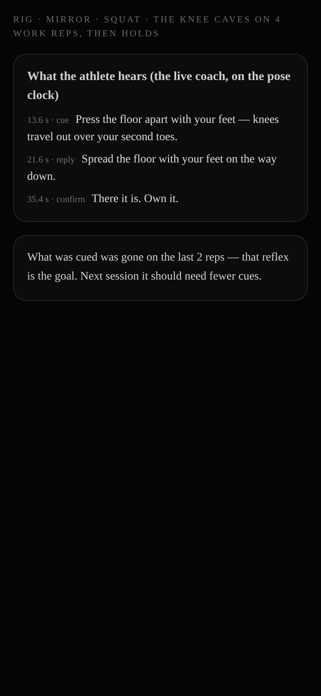
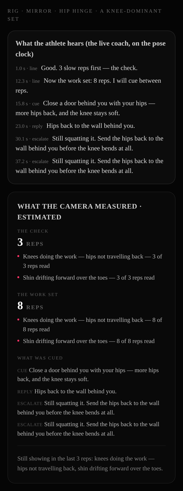
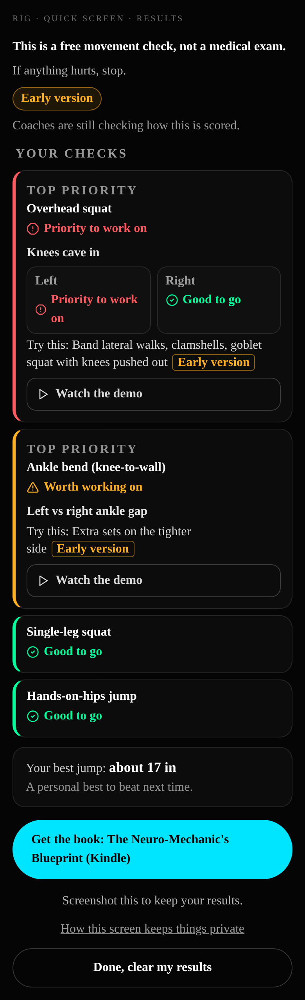
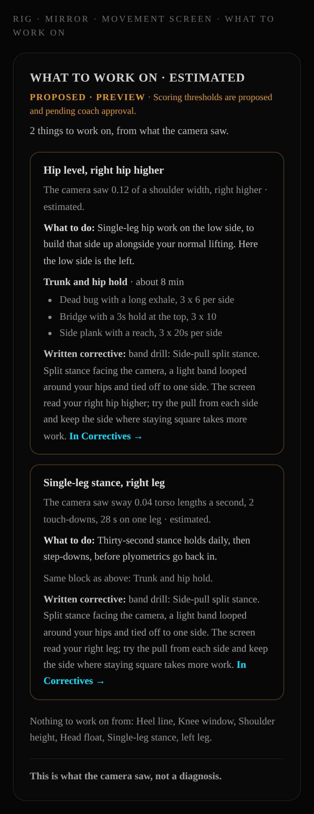
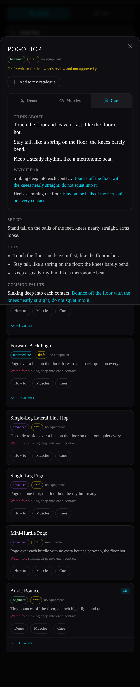

# Cue and results audit (CUE-REWRITE, 2026-10-27)

**Why.** From the owner's playtest (2026-10-27): *"The fitness cueing stuff didn't work well either, it was weird. It
needs heavy revision. The language needs to change. It needs to be clear. It needs to be appropriate. People need to be
able to understand and interpret the results and understand what they are doing."* The owner saw the problem on the
exercise library, the Mirror and its camera coaching, Today's drill, and the programs and session players.

**What this is.** First, an audit of every word a person reads or hears while doing or reviewing a movement. Then the
rewrite, done to the style guide in `docs/CUE-STYLE.md` (which the owner reviews). The before and after of every line
is in the appendices. Today's drill belongs to the today-drill lane and is not in this audit (it has the style guide).
Legal, consent and policy lines are out of scope and unchanged.

## Numbers

| | Count |
|---|---|
| Strings inventoried in scope (the copy modules and components of 9 surfaces, 204 files, by TypeScript AST) | 3,992 |
| Unique exercise-library lines (cues, faults, fixes, set-ups, cautions, across 5,020 entries) | 3,541 |
| **Lines audited** | **7,533** |
| Lines now checked by the copy-screen test, at their tier (`lib/cue-style/corpus.test.ts`) | 726 app lines, 57 result builders, 3,537 library lines |
| **App lines rewritten** (Appendix A) | **468** |
| **Library lines rewritten** (Appendix B; they occur 1,800+ times across entries) | **430** unique |
| **Timing fixes** (measured on synthetic feeds) | **2**: one voice at a time; no live cue after the set ends |
| Copy tests that pinned old strings, updated and marked "test changed: copy rewrite" | 40 files |

**What was wrong, by tag.** A line can carry more than one tag. The tags come from the screen in `lib/cue-style/style.ts`,
plus a coach-jargon list. "Wording" means the line broke no hard rule but read stiffly, so it was made plainer, shorter
or friendlier.

| Problem | App lines | (incl. library) |
|---|---|---|
| Too long to read mid-rep (live coach, screen prompts) | 159 | — |
| Too long for a card (library, programs) | — | 355 |
| Jargon with no plain gloss (valgus, tripod, hinge, cylinder, RNT, axial, thoracic, F0, τ, e1RM, R², "cued", "work set"…) | 155 (both) | |
| Judging tone ("fault", "flagged", "leak", "failing", "weak side", "sloppy") | 40 (both) | |
| A number with no meaning attached ("0.12 of a shoulder width", "sway 0.03 torso lengths a second", "Best 0.62") | 39 | |
| Contradicts another surface (a second name for the same fault) | 31 | |
| No next step, or no meaning (results) | 11 headline/verdict lines, plus every Quick Screen card, jump, bar-speed, sprint and readiness result (§3) | |
| Medical or clinical words (physician, injury, medicine ball) | 7 (both) | |
| Reading level over grade 10 | 9 | |

## 1. The worst offenders, on the rig

All shots were taken on the esbuild + Playwright rig (`scripts/probes/_cue-rewrite-probe.mts`, plus the existing
surface probes) at 390 px, before this lane's changes (lane base `36593d3a`).

**The Mirror's live coach, mid-squat** (shot `docs/cue-audit/before-squat-coach-390.png`). What the athlete heard
in the middle of a rep was a 13-word sentence of images: *"Press the floor apart with your feet — knees travel out over
your second toes."* Then, when the fault cleared, *"There it is. Own it."*. The review was *"What was cued was gone on
the last 2 reps — that reflex is the goal."*

**The hip hinge, a knee-dominant set** (`before-hinge-review-390.png`). The cues were *"Close a door behind you with your
hips — more hips back, and the knee stays soft."* and *"Still squatting it. Send the hips back to the wall behind you
before the knee bends at all."* (17 words), said twice. The review card showed the engine's own words to the athlete:
"ESCALATE", "What was cued", *"Knees doing the work — hips not travelling back — 8 of 8 reps read"*. The first correction
started while the ~4 s stage line was still being said (§4).

**The Quick Screen results** (`before-screen-results-390.png`). Each card was a band word and *"Try this: Band lateral walks,
clamshells, goblet squat with knees pushed out"*: a list of drill names a beginner cannot act on, with no line saying what
the result means. "Left vs right ankle gap / Try this: Extra sets on the tighter side".

**The Movement Screen's "what to work on"** (`before-mirror-steps-390.png`). Numbers with no meaning: *"The camera saw sway
0.04 torso lengths a second, 2 touch-downs, 28 s on one leg · estimated."* Jargon: "PROPOSED · preview · Scoring thresholds
are proposed and pending coach approval", "Trunk and hip hold". Elsewhere in the same result: *"The cylinder is leaking
pressure — breathing is happening at the neck"*, *"Exhale-biased breathing … before any heavy axial loading"*, *"Hip
external-rotation work"*, *"Foot tripod work"*, and "This is not medical clearance — … belongs with a physician".

**The exercise library sheet** (`before-library-sheet-390.png`). Cues ran 17–29 words, and set-ups said "hinge" with no
explanation. "Weaker hand" appeared on 100+ basketball entries. "Medicine ball" tripped the medical-word screen. The
section was headed "COMMON FAULTS".

## 2. Findings by surface

- **Mirror, live coach** (`rules/cue-engine.ts`, `lib/mirror/*Audit.ts`, `*Stage.ts`, `framing.ts`). Every cue, escalation and
  reply ran 7–17 words. The images could not be acted on mid-rep: "Fifty-fifty. Don't travel", "Own the bottom … then
  explode", "Be one stiff plank from the floor up", "Close a door behind you with your hips", "the broomstick line". Coach
  shorthand appeared too: "Reset your tripod", "Ninety-ninety breathing", "Box squat". The confirmation "There it is. Own
  it." The framing lines said "I am guessing", "I read your knees from the front".
- **Mirror, reviews.** There were three names for one knee fault. Engine words reached the athlete ("ESCALATE", "REGRESS",
  "cued every third time it showed"), and so did "No faults measured". Verdicts said what happened but not what to do
  next ("That is the correction working, not failing").
- **Movement Screen** (`screen.ts`, `stationGraders.ts`, `screenCorrectives.ts`, `program.ts`). Station names were jargon
  (Knee window, Head float, Heel line, Rib angle and breath, Pelvic tilt (hands on the hip points)). Values came in units
  nobody pictures ("hip half-widths", "torso lengths a second"). The MEANING and FIX lines used clinical-sounding coach
  language (cylinder, axial loading, external rotation, thoracic extension, plyometrics, tripod). The playbook block titles
  were abstract ("Ask the scapula to set and stay", "Ask the pelvis to stay level"), and its movement names were jargon
  (Prone Y-raise, Scapular pull-up, 90/90 transitions).
- **Form review** (`lib/coach/formReview`). Flags had a third set of names ("knee caves", "Torso drifts", "Stops short").
  A flag stopped at what was seen, with no meaning and no next step. The film-a-set link said "flags the bad one".
- **Quick Screen** (`lib/screen`, `lib/assess`, `results-view.tsx`). Cards had no "what it means". The drill cues were
  lists of jargon. The check names included "Countermovement jump" and "Ankle dorsiflexion". The pain stop said "a
  qualified professional" without telling anyone to stop first.
- **Jump** (`components/jump`, `lib/jump`). "RSI" was unexplained on the session card. There was "% spread", "Force-velocity
  profile … N/kg … Line fit r²", "Sayers formula; Samozino method", and "so it was a countermovement jump". No result
  said what to do next.
- **Bar speed** (`lib/vbt/copy.ts`, `velocity-session.tsx`). The summary card showed "Best 0.62" with no unit and "Speed
  loss 18%" with no meaning. It also had "e1RM ≈", "R²", "Load-velocity line" and "1RM" in the teen line.
- **Sprint** (`lib/sprint/copy.ts`, `run-result.tsx`). The labels were v_max, τ, F0, Pmax, "F-V slope … N·s/m/kg" and
  "Samozino's model". No result said what to do next.
- **Readiness** (`lib/coach/readiness`). A normal or "building" day had no next step. `copy.ts` is held by the
  coach-delivery lane, so its reason lines are proposed for the owner below, not edited here.
- **Library** (`data/library/**`). 486 of 3,541 unique lines broke the guide: length, unglossed "hinge", "tripod" and
  "90/90", "weaker hand", "sloppy", "medicine ball", and grade level.
- **Programs and the session player** (`templateCatalogue.ts`, `warmupContent.ts`, `taxonomy.ts`, the signature programs,
  which take their cues from the library). There were unglossed "hinge" lines, warm-up lines of 26–29 words, and fault
  names of 9 words.

## 3. Results now follow one shape

Every result builder below returns what we saw / what it means / what next (`lib/cue-style/result.ts`), and the copy
screen checks each one:

- the Mirror squat verdict (`squatReviewVerdict`, every kind), the lunge per-side result, and the side-on (hinge,
  push-up) verdict;
- the Movement Screen "what to work on" items, with the new `means`;
- the form-review flags (`flagResult`, every fault of every movement, rendered on the athlete's set result);
- the Quick Screen cards (each check row, plus Green and "not read") and the jump card;
- the jump session card (`data-jump-next`), the bar-speed set (`setResult`), and the sprint run (`RESULT_MEANS` /
  `RESULT_NEXT`);
- readiness (`lib/coach/readiness/next.ts`: every band now ends with a next step).

## 4. Timing, measured

These runs used the harness's own wiring over synthetic pose feeds (`tests/helpers/cueTiming.ts`): 11-rep sets
(3 check + 8 work) of the squat, hinge and push-up, each clean, faulty every rep, faulty every other rep, or fixed
part way. Columns: corrections per work rep · lines overlapping the line before · shortest gap between lines (ms) ·
praise/correction contradictions inside 6 s · live cues said after the set ended.

| Feed | Before | After |
|---|---|---|
| squat, clean | 0 · 0 · — · 0 · 0 | 0 · 0 · — · 0 · 0 |
| squat, knee caves every rep | 0.5 · 0 · 6400 · 0 · 0 | 0.5 · 0 · 6400 · 0 · 0 |
| squat, every other rep | 0.5 · 0 · 6400 · 0 · 0 | same |
| squat, fixed after work rep 4 | 0.25 · 0 · 6400 · 0 · 0 | same |
| hinge, clean | 0 · 0 · 7633 · 0 · 0 | same |
| **hinge, knees every rep** | 0.5 · **1** · **−33** · 0 · 0 | 0.375 · 0 · 3533 · 0 · 0 |
| hinge, every other rep | 0.5 · 0 · 0 · 0 · 0 | 0.375 · 0 · 5533 · 0 · 0 |
| **push-up, sag every rep** | 0.5 · **1** · **−600** · 0 · 0 | 0.375 · 0 · 2400 · 0 · 0 |
| **push-up, every other rep** | 0.5 · **1** · **−600** · 0 · 0 | 0.375 · 0 · 4000 · 0 · 0 |

- **Fix 1: one voice at a time.** The side-on patterns' first correction started 3.0–3.5 s into the ~4 s stage line, so two
  lines played at once. `CueEngine.holdFor` keeps the coach quiet while a line it has said is still being spoken. The
  length comes from `lib/cue-style/speech.ts`: words ÷ 2.5 a second, plus 0.4 s. That is a new estimate, not a tuned
  feel number. It is wired for the side-on stage and turn lines (`sideRepStage.ts`) and, in the harness, for the squat's
  square-up and sit-deeper lines and the lunge's turn line. The fault bookkeeping still runs while the coach waits, and
  detection is unchanged.
- **Fix 2: nothing said after the set ends.** This one was latent: the rep that closes a side-on set could still be
  cued, on the frame the review opened. It showed once Fix 1 moved the first cue, as "Slower. Stay straight." after the
  last push-up. `applySideRepFrame` no longer speaks a live cue on that frame. The rep's faults still reach the review.
- **Unchanged:** the 6 s hold-down, the 12 s escalation window, the faded schedule, the squat's knee gate and every
  detection threshold. There is no contradiction to fix in these feeds. The 6 s window rules out praise followed by a
  correction for the same fault.

## 5. Not changed here, and why (owner calls)

1. **The week-1 Dunk Program cards** (`lib/screen/week1-dunk.ts`) are guarded as word-for-word from
   `programs/DUNK-PROGRAM.md` (the owner's book). They still say "RNT", "Overcoming isometric", "foot tripod collapses",
   "T-spine flow" and "§7.1 or §8.1". A plain-words version is proposed; the owner decides whether the book or the app
   changes:
   - Check-in: *"Does anything hurt today?" and how many hours you slept. If something hurts, stop and tell your coach.*
   - Breath and stack: *The breathing ladder, then the split-stance row and press with slow breaths*
   - Strong: *Strength: slow squat holding a weight at your chest 3 × 8; … Push hard against something that will not move,
     medium effort, 3 × 3 s.*
   - End the set: *Stop the set as soon as: the bounce turns into a thud, your knees bend a lot, your heels sink or your
     arch drops, the rhythm breaks, or anything hurts.*
   - Exit: *Move on from the base when you pass the exit test and the rung 1 test, two sessions in a row each.*
2. **The readiness reason lines** (`lib/coach/readiness/copy.ts`) are being edited by the coach-delivery lane. Proposed
   for when it merges: "past the camera's noise" → "more than the camera's normal wobble"; "under the 7% line your plan
   uses" → "less than the 7% drop your plan watches for". The next step for every band is already added (new file
   `next.ts`).
3. **The Pre-Game Wake-Up and the drills** (`lib/drills/**`) belong to the owner's Playbook and the drills and today-drill
   lanes. They were not touched; the style guide is shared with them.
4. **Recorded voice.** No Mirror or Quick Screen line had a recorded take (`speakNatural` falls back to the device voice).
   The 46 Mirror and Screen rows in `tools/voice/script/coach.csv` now carry the new lines, ready for the voice session.
   The new short replies ("Knees wide") are not in the script yet.
5. **The external-focus cue lint** (`lib/coach/cueLint.ts`) is relaxed for live cues of five words or fewer that name a
   body part with its direction ("Knees out over toes"). The brief's own examples failed it. This is flagged as owner
   call 1 in the guide.

## 6. Files shared with other lanes (copy only, plus the two timing hooks)

- `app/play/mirror/_components/mirror-harness.tsx` (mirror lanes): the review-card words, the stage captions, the titles,
  three `holdFor` lines and an import.
- `app/play/mirror/_components/side-rep-panels.tsx`: review-card words.
- `components/library/library-browser.tsx` (library lanes): "Common faults" → "Watch for", and the "Fix:" prefix.
- `lib/coach/cueLint.ts`: the direction-cue exception.
- `lib/coach/templateCatalogue.ts`, `lib/coach/warmupContent.ts`, `lib/coach/readiness/view.ts` (coach files): copy lines,
  and the readiness next-step hook.
- `lib/library/**` data (`data/library/**`): text fields only, with the validator at 0 issues.
- `tools/voice/script/coach.csv`: the Mirror and Screen rows.
- `scripts/probes/_vbt-probe.mts`: one check's regex ("Estimated max ≈").

## Appendix A — app lines, before → after

Surface, file:line (in the lane's tree), what was wrong, and the rewrite. "(removed or merged)" means the line was folded
into another line or replaced by a shared constant (for example, the canonical names in `lib/cue-style/names.ts`). This
list was generated by aligning each file's strings before and after, so a few rows pair across a reordering.

| # | Surface | Where | Before | What was wrong | After |
|---|---|---|---|---|---|
| A1 | mirror | `lib/mirror/assessment.ts:68` | Full depth — {Math.round(v)}° at the bottom. | wording (plainer, shorter or friendlier) | Full depth: knees bent to about {Math.round(v)}°. |
| A2 | mirror | `lib/mirror/assessment.ts:69` | Part way down — {Math.round(v)}°. There is more range available. | wording (plainer, shorter or friendlier) | Part way down: knees bent to about {Math.round(v)}°. You have more room to go. |
| A3 | mirror | `lib/mirror/assessment.ts:70` | Short of depth at {Math.round(v)}°. Sit further between your feet before you stand up. | wording (plainer, shorter or friendlier) | Not deep enough: knees bent to only about {Math.round(v)}°. Sit lower between your feet. |
| A4 | mirror | `lib/mirror/assessment.ts:71` | Left knee tracks over the foot the whole way. | wording (plainer, shorter or friendlier) | Left knee stays over the foot the whole way. |
| A5 | mirror | `lib/mirror/assessment.ts:72` | Left knee drifts inside the foot a little ({v.toFixed(2)}). | number with no meaning | Left knee moves a little inside the foot. |
| A6 | mirror | `lib/mirror/assessment.ts:73` | Left knee falls inside the foot on the way down ({v.toFixed(2)}). Drive it out over the little toe. | too long to read mid-rep; number with no meaning | Left knee caves in on the way down. Push it out over your toes. |
| A7 | mirror | `lib/mirror/assessment.ts:74` | Right knee tracks over the foot the whole way. | wording (plainer, shorter or friendlier) | Right knee stays over the foot the whole way. |
| A8 | mirror | `lib/mirror/assessment.ts:75` | Right knee drifts inside the foot a little ({v.toFixed(2)}). | number with no meaning | Right knee moves a little inside the foot. |
| A9 | mirror | `lib/mirror/assessment.ts:76` | Right knee falls inside the foot on the way down ({v.toFixed(2)}). Drive it out over the little toe. | too long to read mid-rep; number with no meaning | Right knee caves in on the way down. Push it out over your toes. |
| A10 | mirror | `lib/mirror/assessment.ts:77` | Both sides load evenly — {Math.round(v)}% apart. | wording (plainer, shorter or friendlier) | Weight even on both feet (about {Math.round(v)}% apart). |
| A11 | mirror | `lib/mirror/assessment.ts:78` | One side takes more than the other — {Math.round(v)}% apart. | wording (plainer, shorter or friendlier) | One foot takes a bit more weight (about {Math.round(v)}% more). |
| A12 | mirror | `lib/mirror/assessment.ts:79` | You are {Math.round(v)}% heavier on one side. Slow the descent and split it evenly. | wording (plainer, shorter or friendlier) | About {Math.round(v)}% more weight on one foot. Go down slower and keep it even. |
| A13 | mirror | `lib/mirror/assessment.ts:80` | Chest stays up — {Math.round(v)}° of lean. | wording (plainer, shorter or friendlier) | Chest stays up (about {Math.round(v)}° of lean). |
| A14 | mirror | `lib/mirror/assessment.ts:81` | Some forward lean — {Math.round(v)}°. | wording (plainer, shorter or friendlier) | Some forward lean (about {Math.round(v)}°). |
| A15 | mirror | `lib/mirror/assessment.ts:82` | Chest folds forward to {Math.round(v)}°. Keep the ribs stacked over the hips. | wording (plainer, shorter or friendlier) | Chest drops forward to about {Math.round(v)}°. Keep your shoulders over your hips. |
| A16 | mirror | `lib/mirror/assessment.ts:110` | Not enough of that rep was in frame to grade it. Step back so your whole body is in shot and go again. | too long to read mid-rep | Not enough of that rep was in the shot to score. Step back so your whole body shows, and go again. |
| A17 | mirror | `lib/mirror/assessment.ts:112` | Good squat. The one to work on: {worstCheck.line.toLo} | wording (plainer, shorter or friendlier) | Good squat. One thing to work on: {worstCheck.line.toLo} |
| A18 | mirror | `lib/mirror/assessment.ts:113` | Workable squat with one clear leak. {worstCheck.line} | judging tone | A solid squat with one clear thing to fix. {worstCheck.line} |
| A19 | mirror | `lib/mirror/assessment.ts:114` | This squat has a leak worth fixing before you load it. {worstCheck.line} | judging tone | Fix this before you add weight. {worstCheck.line} |
| A20 | mirror | `lib/mirror/carryAudit.ts:187` | turn to face the camera — the carry reads from the front | too long to read mid-rep | Turn to face the camera. The carry is read from the front. |
| A21 | mirror | `lib/mirror/carryAudit.ts:187` | hold the carry a little longer so the camera can get a steady read | too long to read mid-rep | Hold the carry a little longer so the camera gets a steady look. |
| A22 | mirror | `lib/mirror/carryAudit.ts:228` | trunk lean | wording (plainer, shorter or friendlier) | leaning to one side |
| A23 | mirror | `lib/mirror/carryAudit.ts:228` | hip hike | wording (plainer, shorter or friendlier) | hip hiking up |
| A24 | mirror | `lib/mirror/carryAudit.ts:228` | shoulder shrug | wording (plainer, shorter or friendlier) | shoulder shrugging up |
| A25 | mirror | `lib/mirror/carryAudit.ts:230` | what the camera saw: {faultWords.join(', '} | wording (plainer, shorter or friendlier) | What the camera saw: {faultWords.join(', '}. |
| A26 | mirror | `lib/mirror/carryAudit.ts:230` | what the camera saw: level through the march | wording (plainer, shorter or friendlier) | What the camera saw: level the whole way. |
| A27 | mirror | `lib/mirror/carryAudit.ts:248` | Keep the belt line level as you step — no hiking up on the loaded side. | too long to read mid-rep | Hips level as you step |
| A28 | mirror | `lib/mirror/carryAudit.ts:249` | Still hiking. Shorten the step until the belt line stays level. | too long to read mid-rep | Shorter steps. Hips level. |
| A29 | mirror | `lib/mirror/carryAudit.ts:250` | Set the weight down. Just march the pattern, hips level, then pick it back up. | too long to read mid-rep | Set the weight down. March in place with level hips, then pick it up. |
| A30 | mirror | `lib/mirror/carryAudit.ts:251` | Let the load pull that arm long — the shoulder stays away from your ear. | too long to read mid-rep | Let the weight hang |
| A31 | mirror | `lib/mirror/carryAudit.ts:252` | Still riding up. Switch the load to the other hand for a set and come back to this one. | too long to read mid-rep | Shoulder down, arm long |
| A32 | mirror | `lib/mirror/carryAudit.ts:253` | A lighter load, the same long arm — let the load hang it, then build back up. | too long to read mid-rep | Use a lighter weight and let it pull your arm long. |
| A33 | mirror | `lib/mirror/carryAudit.ts:254` | Grow tall toward the ceiling — shoulders level over your hips. | too long to read mid-rep | Stand tall and level |
| A34 | mirror | `lib/mirror/carryAudit.ts:255` | Still leaning off to one side. Slow the march and find the tall line before you speed back up. | too long to read mid-rep | Slower. Stand tall. |
| A35 | mirror | `lib/mirror/carryAudit.ts:256` | Hold the tall line standing still first, no march, then add the steps back in. | too long to read mid-rep | Stand still and tall first, then add the steps back in. |
| A36 | mirror | `lib/mirror/carryAudit.ts:257` | Find one even beat and keep it for every step. | too long to read mid-rep | Even steps |
| A37 | mirror | `lib/mirror/carryAudit.ts:258` | The beat is still uneven. Count it out loud, same count every step. | too long to read mid-rep | Count each step out loud |
| A38 | mirror | `lib/mirror/carryAudit.ts:259` | Slow it right down — an even, unhurried step matters more than a fast one. | too long to read mid-rep | Slow down. Even, calm steps matter more than fast ones. |
| A39 | mirror | `lib/mirror/framing.ts:106` | Step into the shot — I cannot see you yet. | wording (plainer, shorter or friendlier) | Step into the shot. |
| A40 | mirror | `lib/mirror/framing.ts:107` | Your feet are out of shot. Tilt the phone down or step back. | wording (plainer, shorter or friendlier) | Feet in the shot. Tilt the phone down or step back. |
| A41 | mirror | `lib/mirror/framing.ts:108` | Your head is out of shot. Tilt the phone up or step back. | wording (plainer, shorter or friendlier) | Head in the shot. Tilt the phone up or step back. |
| A42 | mirror | `lib/mirror/framing.ts:109` | Turn and face the camera square-on — I read your knees from the front. | wording (plainer, shorter or friendlier) | Face the camera straight on. |
| A43 | mirror | `lib/mirror/framing.ts:110` | Step back a couple of paces so your whole body stays in shot when you squat. | too long to read mid-rep | Step back two steps. |
| A44 | mirror | `lib/mirror/framing.ts:111` | Come forward a little — you are far enough away that I am guessing. | wording (plainer, shorter or friendlier) | Come a little closer. |
| A45 | mirror | `lib/mirror/framing.ts:113` | More light, or a plainer background — I am losing track of you. | wording (plainer, shorter or friendlier) | More light, please. I am losing you. |
| A46 | mirror | `lib/mirror/framing.ts:200` | Turn all the way around — I read the heel line from behind. | wording (plainer, shorter or friendlier) | Turn around, back to the camera. |
| A47 | mirror | `lib/mirror/framing.ts:202` | Good shot — start when you are ready. | wording (plainer, shorter or friendlier) | Good. Start when you are ready. |
| A48 | mirror | `lib/mirror/hingeAudit.ts:209` | Too little of you in view to tell which side is toward the camera. | too long to read mid-rep | Step back so your whole body is in the shot. |
| A49 | mirror | `lib/mirror/hingeAudit.ts:291` | Estimated: not enough hip travel in this clip to read a hinge ratio. | too long to read mid-rep; jargon | Your hips did not move back enough in this clip to read. Push them back further next time. |
| A50 | mirror | `lib/mirror/hingeAudit.ts:293` | Estimated: hinge ratio {hr.value.toFixed(2)} (hip:knee) · dowel line {faults[1].status ===} · shin {faults[2].status ===} | too long to read mid-rep; jargon; judging tone; number with no meaning | Estimated: your hips bent about {hr.value.toFixed(1)} times as much as your knees · back line {faults[1].status ===} · shins {faults[2].status ===} |
| A51 | mirror | `lib/mirror/hingeAudit.ts:309` | Close a door behind you with your hips — more hips back, and the knee stays soft. | too long to read mid-rep | Hips back, knees soft |
| A52 | mirror | `lib/mirror/hingeAudit.ts:310` | Still squatting it. Send the hips back to the wall behind you before the knee bends at all. | too long to read mid-rep | Slower. Hips back first. |
| A53 | mirror | `lib/mirror/hingeAudit.ts:311` | Hands on a wall or a doorframe. Hinge back only until the stretch stops you, no lower — the range earns itself. | too long to read mid-rep; jargon | Hands on a wall. Push your hips back only as far as is comfortable. |
| A54 | mirror | `lib/mirror/hingeAudit.ts:312` | Hips back to the wall behind you. | wording (plainer, shorter or friendlier) | Hips back |
| A55 | mirror | `lib/mirror/hingeAudit.ts:316` | Hinge as if a broomstick lies along your back — it stays touching your head and your hips. | too long to read mid-rep; jargon | Back flat, like a board |
| A56 | mirror | `lib/mirror/hingeAudit.ts:317` | That line is still breaking. Eyes to a spot on the floor a few feet ahead, then hinge without losing the broomstick. | too long to read mid-rep; jargon | Slower. Keep your back flat. |
| A57 | mirror | `lib/mirror/hingeAudit.ts:318` | Pick a spot on the floor a few feet ahead and hold your eyes there the whole rep — the line follows the eyes. | too long to read mid-rep | Look at a spot on the floor ahead and keep your eyes there. |
| A58 | mirror | `lib/mirror/hingeAudit.ts:319` | Keep the broomstick touching, head to hips. | wording (plainer, shorter or friendlier) | Long, flat back |
| A59 | mirror | `lib/mirror/hingeAudit.ts:323` | Send the hips back toward the wall behind you — the shin stays still, the knee stays put. | too long to read mid-rep | Hips back, shins still |
| A60 | mirror | `lib/mirror/hingeAudit.ts:324` | Still drifting forward. Sit back toward your heels as the hips travel back to the wall. | too long to read mid-rep | Slower. Shins stay still. |
| A61 | mirror | `lib/mirror/hingeAudit.ts:325` | Stand an inch off a wall behind you. If your knee taps it, the shin travelled too far — reset and go slower. | too long to read mid-rep | Face a wall an inch away. If your knee taps it, go slower. |
| A62 | mirror | `lib/mirror/hingeAudit.ts:326` | Hips to the wall, knee stays put. | wording (plainer, shorter or friendlier) | Shins stay still |
| A63 | mirror | `lib/mirror/hingeStage.ts:67` | Head-to-hips line breaking (the broomstick line) | contradicts another surface (a second name for one fault) | Stand side-on to the phone, 2 to 3 m away, phone at hip height. |
| A64 | mirror | `lib/mirror/hingeStage.ts:68` | Knees doing the work — hips not travelling back | contradicts another surface (a second name for one fault) | Hip hinge: push your hips back, back flat. Bodyweight only. If anything hurts, stop and tell your coach. |
| A65 | mirror | `lib/mirror/hingeStage.ts:72` | Shin drifting forward over the toes | wording (plainer, shorter or friendlier) | Stand side-on and tall, arms down. Hold still to start. |
| A66 | mirror | `lib/mirror/hingeStage.ts:65` | Stand side-on to the phone, about 2–3 m away, with the phone at hip height — the camera reads your hips travelling back, which it cannot see from the front. | too long to read mid-rep; reading level | (removed or merged) |
| A67 | mirror | `lib/mirror/hingeStage.ts:66` | Bodyweight only. Hinge only as far as your back stays long, like a broomstick along it from head to hips — stop the set if anything hurts. | too long to read mid-rep; jargon | (removed or merged) |
| A68 | mirror | `lib/mirror/hingeStage.ts:70` | Side-on to the camera, standing tall, arms hanging — the check starts when you are still. | jargon | (removed or merged) |
| A69 | mirror | `lib/mirror/kneeOverlay.ts:68` | KNEES OUT — PRESS THE FLOOR APART | wording (plainer, shorter or friendlier) | KNEES OUT OVER TOES |
| A70 | mirror | `lib/mirror/liveMovements.ts:35` | Corrective Squat | wording (plainer, shorter or friendlier) | Breathe first, then a few slow squats and a full set. The camera watches your knees, heels and balance, and the coach talks you through it. |
| A71 | mirror | `lib/mirror/liveMovements.ts:39` | Breathe first, then a movement check and a work set. Knees, heels, shoulders and weight are read every rep, and the coach cues as you go. | too long to read mid-rep; jargon | Each leg forward in turn, checked five ways, with spoken cues. At the end you see how your two sides compare. |
| A72 | mirror | `lib/mirror/liveMovements.ts:42` | Each leg forward in turn, read the same five ways, with spoken cues as you go, and the two sides compared in the review. | too long to read mid-rep | Hip hinge |
| A73 | mirror | `lib/mirror/liveMovements.ts:43` | Hip Hinge | jargon | Push your hips back and bend at the hips, back flat. Stand side-on. The camera watches your back, hips and shins, and the coach talks between reps. |
| A74 | mirror | `lib/mirror/liveMovements.ts:47` | Side-on: a short check, then a work set. Each rep is read for the head-to-hips line, how far the hips travel back against the knee, and the shin, with spoken cues between reps. | too long to read mid-rep; jargon | Phone on the floor, side-on. The camera watches your body line, hands, head and depth, and the coach talks between reps. |
| A75 | mirror | `lib/mirror/liveMovements.ts:47` | Phone on the floor, side-on: a short check, then a work set. Each rep is read for the body line, the hands, the head and the depth, with spoken cues between reps. | too long to read mid-rep; jargon | (removed or merged) |
| A76 | mirror | `lib/mirror/liveMovements.ts:50` | Split-Stance Press / Row | wording (plainer, shorter or friendlier) | Press and row |
| A77 | mirror | `lib/mirror/liveMovements.ts:51` | Elbow flare, shrug and trunk read on every rep, with spoken cues, and estimated engagement for five zones. | wording (plainer, shorter or friendlier) | One foot forward, pressing and rowing a handle. The camera watches your elbow, shoulder and balance, and the coach talks you through it. |
| A78 | mirror | `lib/mirror/liveMovements.ts:55` | Your jump, estimated from flight time, and your best to beat. | wording (plainer, shorter or friendlier) | Your jump height, estimated from your time in the air, and your best to beat. |
| A79 | mirror | `lib/mirror/liveMovements.ts:59` | A guided screen: six stations in about two minutes, each read as it finishes, then what to work on. | too long to read mid-rep | Six quick stations in about two minutes, then what to work on. |
| A80 | mirror | `lib/mirror/lungeAudit.ts:263` | Press the floor apart with your front foot — knee out over your toes. | too long to read mid-rep | Front knee over toes |
| A81 | mirror | `lib/mirror/lungeAudit.ts:264` | Still drifting in. Slow the descent and keep pressing the floor apart, knee out the whole way down. | too long to read mid-rep | Slow down. Knee out. |
| A82 | mirror | `lib/mirror/lungeAudit.ts:265` | Half range: lunge only as deep as the knee stays out, then build the depth back. | too long to read mid-rep | Lunge only as deep as your knee stays over your toes. |
| A83 | mirror | `lib/mirror/lungeAudit.ts:266` | Front foot presses the floor apart. | wording (plainer, shorter or friendlier) | Knee out |
| A84 | mirror | `lib/mirror/lungeAudit.ts:270` | Square the belt line to the camera — hips level. | too long to read mid-rep | Keep your hips level |
| A85 | mirror | `lib/mirror/lungeAudit.ts:271` | Still tipping. Keep the belt line level all the way down, like a tray you must not spill. | too long to read mid-rep | Slower. Hips level. |
| A86 | mirror | `lib/mirror/lungeAudit.ts:272` | Hold the top, hips level, two seconds, before you descend. | too long to read mid-rep | Hold the top for two seconds, hips level, then go down. |
| A87 | mirror | `lib/mirror/lungeAudit.ts:273` | Belt line level. | wording (plainer, shorter or friendlier) | Hips level |
| A88 | mirror | `lib/mirror/lungeAudit.ts:277` | Sink straight down like an elevator — shoulders stay over your hips the whole rep. | too long to read mid-rep | Straight down, like an elevator |
| A89 | mirror | `lib/mirror/lungeAudit.ts:278` | Still drifting. Reset stacked at the top and hold that line all the way down, not just at the bottom. | too long to read mid-rep | Slower. Straight down. |
| A90 | mirror | `lib/mirror/lungeAudit.ts:279` | Hands on your hips for the set: sink straight down and up like an elevator, then add the reach back. | too long to read mid-rep | Hands on your hips. Sink straight down and up, like an elevator. |
| A91 | mirror | `lib/mirror/lungeAudit.ts:280` | Straight down, like an elevator. | wording (plainer, shorter or friendlier) | Shoulders over hips |
| A92 | mirror | `lib/mirror/lungeAudit.ts:284` | Own the bottom — back knee toward the floor, then drive up. | too long to read mid-rep | Back knee toward the floor |
| A93 | mirror | `lib/mirror/lungeAudit.ts:285` | Deeper. Slow the way down and sit into the full range. | too long to read mid-rep | Slow down. Go lower. |
| A94 | mirror | `lib/mirror/lungeAudit.ts:286` | Elevate the back foot a couple of inches to find the depth, then lower it as the range builds. | too long to read mid-rep | Put the back foot on a low step to find the depth. |
| A95 | mirror | `lib/mirror/lungeAudit.ts:287` | Back knee toward the floor. | wording (plainer, shorter or friendlier) | A little lower |
| A96 | mirror | `lib/mirror/lungeAudit.ts:291` | Grip the floor with the whole front foot — toes spread, foot planted. | too long to read mid-rep | Whole front foot down |
| A97 | mirror | `lib/mirror/lungeAudit.ts:292` | Still wobbling. Slow the tempo down until the front foot stops moving. | too long to read mid-rep | Slow down. Foot still. |
| A98 | mirror | `lib/mirror/lungeAudit.ts:293` | Hold a wall or a rack lightly for balance while the ankle and knee learn the position. | too long to read mid-rep | Hold a wall lightly for balance while you learn the position. |
| A99 | mirror | `lib/mirror/lungeAudit.ts:294` | Whole front foot on the floor. | wording (plainer, shorter or friendlier) | Foot flat |
| A100 | mirror | `lib/mirror/lungeStage.ts:227` | Front knee drifting in off the midline | contradicts another surface (a second name for one fault) | (removed or merged) |
| A101 | mirror | `lib/mirror/lungeStage.ts:228` | Hips tipping to one side | wording (plainer, shorter or friendlier) | (removed or merged) |
| A102 | mirror | `lib/mirror/lungeStage.ts:229` | Torso drifting off the start line | contradicts another surface (a second name for one fault) | (removed or merged) |
| A103 | mirror | `lib/mirror/lungeStage.ts:230` | Shallow depth | contradicts another surface (a second name for one fault) | (removed or merged) |
| A104 | mirror | `lib/mirror/lungeStage.ts:231` | Front knee wobbling side to side | wording (plainer, shorter or friendlier) | (removed or merged) |
| A105 | mirror | `lib/mirror/overheadAudit.ts:71` | Reach for the ceiling — all the way up, past your ears, not out to the sides. | too long to read mid-rep | Reach all the way up |
| A106 | mirror | `lib/mirror/overheadAudit.ts:72` | Still stopping short. Slow the press and finish tall before you come back down. | too long to read mid-rep | Slower. Finish tall. |
| A107 | mirror | `lib/mirror/overheadAudit.ts:73` | Half the range, both arms even — build the reach before you chase the top. | too long to read mid-rep | Reach halfway with both arms, then build up to the top. |
| A108 | mirror | `lib/mirror/overheadAudit.ts:74` | Touch the ceiling with both hands at once — the same height, together. | too long to read mid-rep | Both hands up together |
| A109 | mirror | `lib/mirror/overheadAudit.ts:75` | Still uneven. Slow down until both hands reach the same spot on the ceiling together. | too long to read mid-rep | Slower. Hands level. |
| A110 | mirror | `lib/mirror/overheadAudit.ts:76` | One arm at a time, in front of a mirror, until they match. | too long to read mid-rep | One arm at a time in front of a mirror, until they match. |
| A111 | mirror | `lib/mirror/overheadAudit.ts:77` | Reach up for the ceiling, long and easy — shoulders stay away from your ears. | too long to read mid-rep | Reach up, shoulders down |
| A112 | mirror | `lib/mirror/overheadAudit.ts:78` | Still climbing. Let the arms hang long first, then reach for the ceiling. | too long to read mid-rep | Slower. Shoulders down. |
| A113 | mirror | `lib/mirror/overheadAudit.ts:79` | Lighter reach, shoulders pinned — the arm does the reaching, not the neck. | too long to read mid-rep | Reach less. Keep your shoulders down while your arms go up. |
| A114 | mirror | `lib/mirror/overheadAudit.ts:80` | Lock it out at the top — arm straight, not stopping bent. | too long to read mid-rep | Arms straight at the top |
| A115 | mirror | `lib/mirror/overheadAudit.ts:81` | Still finishing bent. Punch the ceiling at the top before you lower. | too long to read mid-rep | Punch the ceiling |
| A116 | mirror | `lib/mirror/overheadAudit.ts:82` | Smaller range, but straight at the top every time. | too long to read mid-rep | Use a smaller reach, but straighten your arms at the top every time. |
| A117 | mirror | `lib/mirror/pressRowStage.ts:55` | Working elbow rising toward shoulder height | contradicts another surface (a second name for one fault) | (removed or merged) |
| A118 | mirror | `lib/mirror/pressRowStage.ts:56` | Working shoulder riding up on the pull | wording (plainer, shorter or friendlier) | (removed or merged) |
| A119 | mirror | `lib/mirror/pressRowStage.ts:57` | Shoulders drifting sideways off the hips | contradicts another surface (a second name for one fault) | (removed or merged) |
| A120 | mirror | `lib/mirror/program.ts:115` | Open the ribcage | wording (plainer, shorter or friendlier) | Loosen the upper back |
| A121 | mirror | `lib/mirror/program.ts:115` | Side-lying open book, 6 per side | wording (plainer, shorter or friendlier) | Open book: lie on your side and open your top arm, 6 per side |
| A122 | mirror | `lib/mirror/program.ts:116` | Ask the mid-back to hold | wording (plainer, shorter or friendlier) | Hold a tall upper back |
| A123 | mirror | `lib/mirror/program.ts:116` | Prone Y-raise, 3 x 10 | jargon; number with no meaning | Face-down Y-raise, arms up in a Y, 3 x 10 |
| A124 | mirror | `lib/mirror/program.ts:117` | Keep the ribs stacked under load | wording (plainer, shorter or friendlier) | Stay tall while you press |
| A125 | mirror | `lib/mirror/program.ts:120` | Settle the hips | wording (plainer, shorter or friendlier) | Loosen the hips |
| A126 | mirror | `lib/mirror/program.ts:120` | 90/90 transitions, 8 per side | jargon | Seated knee switches: both knees bent, tip them side to side, 8 per side |
| A127 | mirror | `lib/mirror/program.ts:121` | Ask the pelvis to stay level | jargon | Keep your hips level |
| A128 | mirror | `lib/mirror/program.ts:121` | Dead bug with a long exhale, 3 x 6 per side | wording (plainer, shorter or friendlier) | Dead bug: on your back, lower one arm and the other leg, breathing out, 3 x 6 per side |
| A129 | mirror | `lib/mirror/program.ts:122` | Hold the stack through a hinge | jargon | Stay tall as you bend at the hips |
| A130 | mirror | `lib/mirror/program.ts:122` | Hip hinge to a dowel, 4 x 8 | jargon; number with no meaning | Hip hinge (hips back, back flat) with a stick along your back, 4 x 8 |
| A131 | mirror | `lib/mirror/program.ts:125` | Let the shoulders down | wording (plainer, shorter or friendlier) | Let your shoulders drop |
| A132 | mirror | `lib/mirror/program.ts:126` | Ask the lower shoulder to work | wording (plainer, shorter or friendlier) | Keep your shoulders down |
| A133 | mirror | `lib/mirror/program.ts:126` | Prone T-raise, 3 x 10 | jargon; number with no meaning | Face-down T-raise, arms out in a T, 3 x 10 |
| A134 | mirror | `lib/mirror/program.ts:126` | Scapular pull-up, 3 x 6 | jargon; number with no meaning | Hang from a bar and pull your shoulders down, 3 x 6 |
| A135 | mirror | `lib/mirror/program.ts:126` | Bottoms-up carry, 3 x 20s per side | wording (plainer, shorter or friendlier) | Carry a kettlebell upside down, 3 x 20s per side |
| A136 | mirror | `lib/mirror/program.ts:127` | Press without the shrug | wording (plainer, shorter or friendlier) | Press without shrugging |
| A137 | mirror | `lib/mirror/program.ts:127` | Landmine press, 3 x 8 per side | wording (plainer, shorter or friendlier) | Landmine press (one end of a bar in a corner), 3 x 8 per side |
| A138 | mirror | `lib/mirror/program.ts:130` | Free the reach overhead | wording (plainer, shorter or friendlier) | Free up your overhead reach |
| A139 | mirror | `lib/mirror/program.ts:131` | Ask the scapula to set and stay | jargon | Set your shoulder blades |
| A140 | mirror | `lib/mirror/program.ts:131` | Prone W-raise, 3 x 10 | jargon; number with no meaning | Face-down W-raise, elbows bent in a W, 3 x 10 |
| A141 | mirror | `lib/mirror/program.ts:132` | Row from a set shoulder | wording (plainer, shorter or friendlier) | Row with your shoulders set |
| A142 | mirror | `lib/mirror/program.ts:135` | Free the back of the leg | wording (plainer, shorter or friendlier) | Loosen the back of your legs |
| A143 | mirror | `lib/mirror/program.ts:136` | Ask the hips to lead the hinge | jargon | Lead with your hips |
| A144 | mirror | `lib/mirror/program.ts:136` | Hip hinge to a wall, 3 x 10 | jargon; number with no meaning | Hip hinge: push your hips back to touch a wall, 3 x 10 |
| A145 | mirror | `lib/mirror/program.ts:136` | Slow Romanian deadlift with a dowel, 3 x 8 | number with no meaning | Slow Romanian deadlift: hips back, a stick down your legs, 3 x 8 |
| A146 | mirror | `lib/mirror/program.ts:137` | Hinge without folding forward | jargon | Bend at the hips, back flat |
| A147 | mirror | `lib/mirror/program.ts:137` | Hinge to a target with a band at the hips, 4 x 8 | jargon; number with no meaning | Push your hips back to a target, a band around your hips, 4 x 8 |
| A148 | mirror | `lib/mirror/program.ts:137` | Split-stance press from a hinge, 3 x 6 per side | jargon | Split-stance press, bent at the hips with a flat back, 3 x 6 per side |
| A149 | mirror | `lib/mirror/program.ts:225` | Scan a couple more times and a program will build itself from what shows up. | wording (plainer, shorter or friendlier) | Do a couple more sets with the camera, and a plan will build from what it sees. |
| A150 | mirror | `lib/mirror/program.ts:226` | Nothing showed up often enough to program for — keep moving the way you are. | wording (plainer, shorter or friendlier) | Nothing showed up often enough to need a plan. Keep moving the way you are. |
| A151 | mirror | `lib/mirror/program.ts:329` | Your next press/row set in the Mirror is the retest: it shows whether these turned up less often. | wording (plainer, shorter or friendlier) | Your next press and row set in the Mirror is the check-up: it shows if these happen less often. |
| A152 | mirror | `lib/mirror/program.ts:330` | Retest in {sessionsToRetest} press/row sets in the Mirror. The program stays the same until then. | wording (plainer, shorter or friendlier) | Check-up in {sessionsToRetest} press and row sets in the Mirror. The plan stays the same until then. |
| A153 | mirror | `lib/mirror/progressReading.ts:83` | Zone faults per rep | jargon; judging tone | Things to fix per rep |
| A154 | mirror | `lib/mirror/progressReading.ts:192` | Kept on this phone only — never sent. Forget it any time. | wording (plainer, shorter or friendlier) | Kept on this phone only, never sent. You can delete it any time. |
| A155 | mirror | `lib/mirror/progressReading.ts:193` | Too few reps were read to compare — {PROGRESS_MIN_REPS} or more counts. | wording (plainer, shorter or friendlier) | Too few reps were read to compare. Do {PROGRESS_MIN_REPS} or more next time. |
| A156 | mirror | `lib/mirror/progressReading.ts:194` | First one on record — your next set is compared with this one. | wording (plainer, shorter or friendlier) | Your first set on record. Next time, we compare with this one. |
| A157 | mirror | `lib/mirror/progressReading.ts:195` | Your saved sessions could not be read just now — no comparison this time. | wording (plainer, shorter or friendlier) | Your saved sessions could not be loaded just now, so no comparison this time. |
| A158 | mirror | `lib/mirror/progressReading.ts:196` | This phone is not keeping a history (private browsing or blocked storage), so there is nothing to compare. | wording (plainer, shorter or friendlier) | This phone is not keeping a history (private browsing, or storage is off), so there is nothing to compare. |
| A159 | mirror | `lib/mirror/progressReading.ts:199` | Better than your last {n === 1 ? 'set' : n}. | wording (plainer, shorter or friendlier) | Better than your last {n === 1 ? 'set' : n}. Keep doing what you did. |
| A160 | mirror | `lib/mirror/progressReading.ts:200` | About the same as your last {n === 1 ? 'set' : n}. | wording (plainer, shorter or friendlier) | About the same as your last {n === 1 ? 'set' : n}. Keep at it. |
| A161 | mirror | `lib/mirror/progressReading.ts:201` | Not as clean as your last {n === 1 ? 'set' : n}. | wording (plainer, shorter or friendlier) | Not as clean as your last {n === 1 ? 'set' : n}. Next set, go a little slower. |
| A162 | mirror | `lib/mirror/pushupAudit.ts:98` | All the way down — chest to a fist off the floor. | too long to read mid-rep | Chest close to the floor |
| A163 | mirror | `lib/mirror/pushupAudit.ts:99` | Still stopping short. Slow the descent and own the bottom before you press. | too long to read mid-rep | Slower. All the way down. |
| A164 | mirror | `lib/mirror/pushupAudit.ts:100` | Knees down. Same line, same depth, less weight to press. | too long to read mid-rep | Knees down. Same straight body, same depth. |
| A165 | mirror | `lib/mirror/pushupAudit.ts:101` | Chest to a fist off the floor. | wording (plainer, shorter or friendlier) | Lower, then push |
| A166 | mirror | `lib/mirror/pushupAudit.ts:102` | Be one stiff plank from the floor up — a straight line, head to heels, before you move. | too long to read mid-rep | Body straight like a plank |
| A167 | mirror | `lib/mirror/pushupAudit.ts:103` | Still bending in the middle. Push the floor away and move as one stiff plank. | too long to read mid-rep | Slower. Stay straight. |
| A168 | mirror | `lib/mirror/pushupAudit.ts:104` | Knees down, or hands on a box — same line, less line to hold. | too long to read mid-rep | Knees down, or hands on a box. Keep your body straight. |
| A169 | mirror | `lib/mirror/pushupAudit.ts:105` | One stiff plank from the floor up. | wording (plainer, shorter or friendlier) | Push the floor away |
| A170 | mirror | `lib/mirror/pushupAudit.ts:106` | Eyes on the floor just past your hands — a long neck, not a reaching chin. | too long to read mid-rep | Look at the floor ahead |
| A171 | mirror | `lib/mirror/pushupAudit.ts:107` | Still reaching. Eyes back down to a spot on the floor just past your hands. | too long to read mid-rep | Slower. Eyes on the floor. |
| A172 | mirror | `lib/mirror/pushupAudit.ts:108` | Pause at the top. Set the neck first, THEN start the rep. | too long to read mid-rep | Pause at the top. Set your head in line, then start. |
| A173 | mirror | `lib/mirror/pushupAudit.ts:109` | Eyes on the floor past your hands. | wording (plainer, shorter or friendlier) | Eyes on the floor |
| A174 | mirror | `lib/mirror/pushupAudit.ts:110` | Set the hands on the floor right under the shoulders before you go down. | too long to read mid-rep | Hands right under your shoulders |
| A175 | mirror | `lib/mirror/pushupAudit.ts:111` | Still walked out. Reset the top position — hands under shoulders, then descend. | too long to read mid-rep | Reset. Hands under shoulders. |
| A176 | mirror | `lib/mirror/pushupAudit.ts:112` | From your knees: set the hands under the shoulders, hold two seconds, then rep. | too long to read mid-rep | From your knees: hands under shoulders, hold two seconds, then go. |
| A177 | mirror | `lib/mirror/pushupAudit.ts:113` | Hands on the floor under the shoulders. | wording (plainer, shorter or friendlier) | Hands under shoulders |
| A178 | mirror | `lib/mirror/pushupStage.ts:76` | Hips off the head-to-heels line (sagging or piking) | contradicts another surface (a second name for one fault) | Phone on the floor, side-on, about 2 m away, so it sees you head to heels. |
| A179 | mirror | `lib/mirror/pushupStage.ts:77` | Hands not under the shoulders at the top | wording (plainer, shorter or friendlier) | Push-ups from your knees count too. If anything hurts, stop and tell your coach. |
| A180 | mirror | `lib/mirror/pushupStage.ts:81` | Head reaching off the body line | wording (plainer, shorter or friendlier) | Side-on, at the top of your push-up, arms straight. Hold still to start. |
| A181 | mirror | `lib/mirror/pushupStage.ts:30` | Reps stopping short of the bottom | contradicts another surface (a second name for one fault) | (removed or merged) |
| A182 | mirror | `lib/mirror/pushupStage.ts:74` | Put the phone on the floor, side-on to you, about 2 m away, so it sees you from head to heels — the camera reads your body line and depth from the side. | too long to read mid-rep; reading level | (removed or merged) |
| A183 | mirror | `lib/mirror/pushupStage.ts:75` | Knees down is a push-up too: the Mirror reads that variant the same way. Stop the set if anything hurts. | too long to read mid-rep | (removed or merged) |
| A184 | mirror | `lib/mirror/pushupStage.ts:79` | Side-on to the camera, in your plank with straight arms — the check starts when you are still. | jargon | (removed or merged) |
| A185 | mirror | `lib/mirror/screen.ts:70` | Turn side-on — left shoulder to the camera. | wording (plainer, shorter or friendlier) | Turn side-on, left shoulder to the camera. |
| A186 | mirror | `lib/mirror/screen.ts:71` | Turn all the way around, back to the camera. | wording (plainer, shorter or friendlier) | Turn around, back to the camera. |
| A187 | mirror | `lib/mirror/screen.ts:78` | Heel line | contradicts another surface (a second name for one fault) | Heels from behind |
| A188 | mirror | `lib/mirror/screen.ts:79` | One heel line reads tilted from behind; the other does not. | wording (plainer, shorter or friendlier) | From behind, one heel tilts and the other does not. |
| A189 | mirror | `lib/mirror/screen.ts:82` | Knee window | contradicts another surface (a second name for one fault) | Knees from the front |
| A190 | mirror | `lib/mirror/screen.ts:85` | A knee sits inside the line from its hip to its ankle. | wording (plainer, shorter or friendlier) | A knee sits inside the line from hip to ankle. |
| A191 | mirror | `lib/mirror/screen.ts:91` | One hip sits noticeably higher than the other. | wording (plainer, shorter or friendlier) | One hip sits clearly higher than the other. |
| A192 | mirror | `lib/mirror/screen.ts:95` | Rib angle and breath | contradicts another surface (a second name for one fault) | Breathing moves the shoulders and neck more than the lower ribs. |
| A193 | mirror | `lib/mirror/screen.ts:98` | A wide flared rib V with neck-muscle breathing instead of the lower ribs widening. | wording (plainer, shorter or friendlier) | Head position |
| A194 | mirror | `lib/mirror/screen.ts:99` | Head float | contradicts another surface (a second name for one fault) | The ear sits clearly in front of the shoulder. |
| A195 | mirror | `lib/mirror/screen.ts:102` | The ear sits clearly forward of the shoulder. | wording (plainer, shorter or friendlier) | One-leg balance, 30 seconds a side |
| A196 | mirror | `lib/mirror/screen.ts:105` | Single-leg stance, 30 seconds a side | wording (plainer, shorter or friendlier) | On one leg, the free foot came down or the hips swayed a lot. |
| A197 | mirror | `lib/mirror/screen.ts:108` | Cannot hold thirty seconds on one leg without the free foot coming down or the hips swaying clearly. | wording (plainer, shorter or friendlier) | Pelvis tilt (coach checks) |
| A198 | mirror | `lib/mirror/screen.ts:109` | Pelvic tilt (hands on the hip points) | jargon | The front of the hips sits well below or well above the back. |
| A199 | mirror | `lib/mirror/screen.ts:112` | The front of the pelvis sits well below the back of it, or well above. | jargon | Seated turn, each side |
| A200 | mirror | `lib/mirror/screen.ts:113` | Seated rotation, each side | wording (plainer, shorter or friendlier) | You turn clearly less to one side than the other. |
| A201 | mirror | `lib/mirror/screen.ts:116` | Clearly less rotation to one side than the other. | wording (plainer, shorter or friendlier) | Shoulder level |
| A202 | mirror | `lib/mirror/screen.ts:117` | Shoulder height | wording (plainer, shorter or friendlier) | One shoulder sits higher than the other when you stand relaxed. |
| A203 | mirror | `lib/mirror/screen.ts:127` | One shoulder rides higher than the other in a default stance. | wording (plainer, shorter or friendlier) | Turn around, back to the camera. Feet hip-width, toes straight ahead. Look ahead. |
| A204 | mirror | `lib/mirror/screen.ts:128` | Turn all the way around, back to the camera. Feet about hip-width, toes pointing straight ahead. Look straight ahead. | too long to read mid-rep | Turn and face the camera. Stand the same way. Do not fix anything. |
| A205 | mirror | `lib/mirror/screen.ts:132` | Turn and face the camera. Same stance — do not fix anything. | wording (plainer, shorter or friendlier) | Hands on the sides of your lower ribs. Take one easy breath in and out. Two questions come at the end. |
| A206 | mirror | `lib/mirror/screen.ts:133` | Stay facing me. Hands on the sides of your lower ribs, and take one easy breath in and out. Two quick questions about it at the end. | too long to read mid-rep | Turn side-on, left shoulder to the camera. Look straight ahead. |
| A207 | mirror | `lib/mirror/screen.ts:134` | Turn side-on — left shoulder to the camera. Look straight ahead. | wording (plainer, shorter or friendlier) | Face me. Stand on your LEFT leg, other knee up to hip height, arms down. |
| A208 | mirror | `lib/mirror/screen.ts:135` | Face me. Stand on your LEFT leg, other knee up to hip height, arms by your sides. | wording (plainer, shorter or friendlier) | Now the RIGHT leg. Same thing, thirty seconds. |
| A209 | mirror | `lib/mirror/screen.ts:144` | Now the RIGHT leg. Same thing — thirty seconds. | wording (plainer, shorter or friendlier) | Stay side-on. If a coach is with you, they can check your hips now. |
| A210 | mirror | `lib/mirror/screen.ts:145` | Stay side-on. If a coach is with you, they can check the pelvis now. | jargon | Sit tall and turn to each side as far as is comfortable. |
| A211 | mirror | `lib/mirror/screen.ts:145` | Sit tall and rotate to each side as far as is comfortable. | wording (plainer, shorter or friendlier) | (removed or merged) |
| A212 | mirror | `lib/mirror/screen.ts:484` | From behind, one heel line tilts and the other does not, so the two feet are not giving the legs the same base. | too long to read mid-rep | Your two feet are not giving your legs the same base. |
| A213 | mirror | `lib/mirror/screen.ts:485` | Standing relaxed, a knee sits inside the line from hip to ankle — worth watching when you squat, land and cut. | too long to read mid-rep | Worth watching when you squat, land and cut. |
| A214 | mirror | `lib/mirror/screen.ts:486` | Standing relaxed, one hip reads higher than the other, so the two sides start from a tilt. | wording (plainer, shorter or friendlier) | Your two sides start from a tilt. |
| A215 | mirror | `lib/mirror/screen.ts:487` | Standing relaxed, one shoulder rides higher than the other. | wording (plainer, shorter or friendlier) | Your two sides start from a tilt. |
| A216 | mirror | `lib/mirror/screen.ts:488` | The cylinder is leaking pressure — breathing is happening at the neck instead of the lower ribs. | jargon | Your breath is moving your neck and shoulders more than your ribs. |
| A217 | mirror | `lib/mirror/screen.ts:489` | From the side, the ear sits ahead of the shoulder, so the head is carried forward of the trunk. | too long to read mid-rep | Your head is carried in front of your body. |
| A218 | mirror | `lib/mirror/screen.ts:490` | Thirty seconds on one leg was hard to hold still on this side, and one leg is where every stride and landing happens. | too long to read mid-rep | Holding still was hard on this side, and every stride and landing happens on one leg. |
| A219 | mirror | `lib/mirror/screen.ts:491` | The pelvis is parked at one end of its range rather than sitting in the middle of it. | jargon | Your hips sit tipped to one end instead of in the middle. |
| A220 | mirror | `lib/mirror/screen.ts:492` | Rotation is not shared evenly between the two sides. | wording (plainer, shorter or friendlier) | Your turn is not shared evenly between the two sides. |
| A221 | mirror | `lib/mirror/screen.ts:496` | Foot tripod work before anything loaded — short-foot holds, then slow calf raises with the heel tracking straight. | jargon | Foot work before any weights: press heel, big toe and little toe into the floor, then do slow calf raises. |
| A222 | mirror | `lib/mirror/screen.ts:497` | Hip external-rotation work and banded side steps, then slow tempo squats watching the knee track over the second toe. | too long to read mid-rep; jargon | Side steps with a band, then slow squats watching your knee stay over your middle toes. |
| A223 | mirror | `lib/mirror/screen.ts:498` | Single-leg hip work on the low side, to build that side up alongside your normal lifting. | wording (plainer, shorter or friendlier) | Do one-leg moves on the lower side, as well as your usual training. |
| A224 | mirror | `lib/mirror/screen.ts:499` | Breathing work first, then easy rotation drills to both sides. | wording (plainer, shorter or friendlier) | Slow breathing first, then easy turning drills to both sides. |
| A225 | mirror | `lib/mirror/screen.ts:500` | Exhale-biased breathing — long exhales, ribs down — before any heavy axial loading. | jargon; reading level | Long, slow breaths out, ribs down, before any heavy lifting over your head or on your back. |
| A226 | mirror | `lib/mirror/screen.ts:501` | Chin nods and thoracic extension over a roller, and raise the screen you are looking at all day. | jargon | Small chin nods, upper-back stretches over a roller, and raise the screen you look at all day. |
| A227 | mirror | `lib/mirror/screen.ts:502` | Thirty-second stance holds daily, then step-downs, before plyometrics go back in. | jargon | Stand on one leg for thirty seconds each day. Then add slow step-downs, then jumps. |
| A228 | mirror | `lib/mirror/screen.ts:503` | Position work at both ends of the pelvis range so it can sit in the middle. | jargon | Practice tipping your hips both ways so they can rest in the middle. |
| A229 | mirror | `lib/mirror/screen.ts:504` | Rotation work to the restricted side, held, not bounced. | wording (plainer, shorter or friendlier) | Turning drills to the stiffer side: hold each turn, do not bounce. |
| A230 | mirror | `lib/mirror/screen.ts:602` | Keep practising skills at controlled intensity. | wording (plainer, shorter or friendlier) | Keep practising your skills at an easy to medium effort. |
| A231 | mirror | `lib/mirror/screen.ts:603` | Build the corrective work above into every session, and have a coach look at these flags in person. | wording (plainer, shorter or friendlier) | Add the work above to every session, and have a coach look at these in person. |
| A232 | mirror | `lib/mirror/screen.ts:605` | This is not medical clearance — pain, swelling, numbness or a pop belongs with a physician. | medical word | This is not medical clearance. If anything hurts, swells or goes numb, stop and see a health professional. |
| A233 | mirror | `lib/mirror/screen.ts:607` | Do the corrective work above before you add intensity, not instead of training. | wording (plainer, shorter or friendlier) | Do the work above before you train harder, not instead of training. |
| A234 | mirror | `lib/mirror/screen.ts:608` | Re-run this screen in two weeks and compare the sides. | wording (plainer, shorter or friendlier) | Run this screen again in two weeks and compare your sides. |
| A235 | mirror | `lib/mirror/screen.ts:612` | Train normally. | wording (plainer, shorter or friendlier) | Train as normal. |
| A236 | mirror | `lib/mirror/screen.ts:612` | Re-run this screen monthly, or after an ankle injury, a growth spurt, or a jump in workload. | medical word | Run this screen again each month, or after a growth spurt, a long break, or a big jump in training. |
| A237 | mirror | `lib/mirror/screen.ts:632` | Partly graded: {counted} and none flagged; not read: {notRead.join(', ')} — so this is not a clear screen. | judging tone | Partly read: {counted}, nothing to work on. Not read: {notRead.join(', ')}. So this is not a full screen yet. |
| A238 | mirror | `lib/mirror/screen.ts:634` | Nothing flagged. That is a platform you can load. | judging tone; no next step / no meaning | Nothing to work on. You are ready to train harder. |
| A239 | mirror | `lib/mirror/screenCorrectives.ts:57` | Not read: no reading came back for this check. | wording (plainer, shorter or friendlier) | Not read: the camera got nothing for this check. |
| A240 | mirror | `lib/mirror/screenCorrectives.ts:59` | Run this station again next time. | wording (plainer, shorter or friendlier) | Do this part again next time. |
| A241 | mirror | `lib/mirror/screenCorrectives.ts:63` | Heel line | contradicts another surface (a second name for one fault) | Heels from behind |
| A242 | mirror | `lib/mirror/screenCorrectives.ts:63` | Knee window | contradicts another surface (a second name for one fault) | Knees from the front |
| A243 | mirror | `lib/mirror/screenCorrectives.ts:64` | Shoulder height | wording (plainer, shorter or friendlier) | Shoulder level |
| A244 | mirror | `lib/mirror/screenCorrectives.ts:64` | Head float | contradicts another surface (a second name for one fault) | Head position |
| A245 | mirror | `lib/mirror/screenCorrectives.ts:64` | Single-leg stance | wording (plainer, shorter or friendlier) | One-leg balance |
| A246 | mirror | `lib/mirror/screenCorrectives.ts:77` | Trunk and hip hold | wording (plainer, shorter or friendlier) | Hip and middle hold |
| A247 | mirror | `lib/mirror/screenCorrectives.ts:78` | Trunk and hip hold | wording (plainer, shorter or friendlier) | Hip and middle hold |
| A248 | mirror | `lib/mirror/screenCorrectives.ts:274` | Corrective blocks are off under 18 for now. The fix above is the work — do it with your coach or a parent. | too long to read mid-rep; number with no meaning | The extra drill blocks are for adults for now. Do the fix above with your coach or a parent. |
| A249 | mirror | `lib/mirror/screenCorrectives.ts:275` | Corrective blocks are off until your birth year is on your account (they are for adults for now). The fix above is the work. | too long to read mid-rep | The extra drill blocks are for adults. Add your birth year to your account to see them. The fix above is the work. |
| A250 | mirror | `lib/mirror/screenCorrectives.ts:294` | The camera saw {o.value}. | wording (plainer, shorter or friendlier) | The camera saw: {o.value}. |
| A251 | mirror | `lib/mirror/screenCorrectives.ts:294` | The camera flagged this one for a closer look. | judging tone | The camera marked this one as worth working on. |
| A252 | mirror | `lib/mirror/screenCorrectives.ts:311` | Nothing flagged in what the camera read. Some checks were not read, so run those again before you call it done. | too long to read mid-rep; judging tone; no next step / no meaning | Nothing to work on in what the camera read. Some checks were not read, so run those again. |
| A253 | mirror | `lib/mirror/screenCorrectives.ts:312` | Nothing flagged in any check the camera read. | judging tone; no next step / no meaning | Nothing to work on in any check the camera read. |
| A254 | mirror | `lib/mirror/screenRunner.ts:154` | I couldn't read that one — once more.{hint ? ` ${hint}` : } | wording (plainer, shorter or friendlier) | I couldn't see that one. Once more.{hint ? ` ${hint}` : } |
| A255 | mirror | `lib/mirror/setupLine.ts:97` | Hips are riding high — sit them down toward the bar, knees add the bend. | too long to read mid-rep | Hips too high. Sit them down toward the bar and bend your knees more. |
| A256 | mirror | `lib/mirror/setupLine.ts:98` | Hips are low for a pull — this reads as a squat stance. Hips up a touch, chest over the bar. | too long to read mid-rep | Hips too low for a lift from the floor. Raise them a little, chest over the bar. |
| A257 | mirror | `lib/mirror/setupLine.ts:99` | Shoulders are behind the bar — bring your chest over it a touch. | too long to read mid-rep | Shoulders behind the bar. Bring your chest over it a little. |
| A258 | mirror | `lib/mirror/setupLine.ts:100` | Set your head in line first — one long line from your ears to your hips. | too long to read mid-rep | Head out of line. Keep one long line from your ears to your hips. |
| A259 | mirror | `lib/mirror/setupLine.ts:101` | Can't see your hips and knees well enough to check your set-up — square up in frame. | too long to read mid-rep | I can't see your hips and knees. Turn side-on and get your whole body in the shot. |
| A260 | mirror | `lib/mirror/setupLine.ts:102` | Can't see the bar hand well enough to check your set-up — bring it into frame. | too long to read mid-rep | I can't see the hand on the bar. Bring it into the shot. |
| A261 | mirror | `lib/mirror/setupLine.ts:103` | Can't see your head and shoulders well enough to check your set-up — square up in frame. | too long to read mid-rep | I can't see your head and shoulders. Get your whole body in the shot. |
| A262 | mirror | `lib/mirror/setupLine.ts:124` | Too little of you in view to tell which side is toward the camera. | too long to read mid-rep | Step back so your whole body is in the shot. |
| A263 | mirror | `lib/mirror/setupLine.ts:184` | Sit your hips down level with the bar — let your knees add the bend, not your back. | too long to read mid-rep | Hips down to bar height |
| A264 | mirror | `lib/mirror/setupLine.ts:185` | Still riding high. Touch the bar to the floor from a dead stop before you set up again. | too long to read mid-rep | Reset. Hips lower. |
| A265 | mirror | `lib/mirror/setupLine.ts:186` | Set up from blocks or a rack pin a few inches up, so the hips do not have as far to travel yet. | too long to read mid-rep | Set the bar on blocks a few inches up, so your hips travel less. |
| A266 | mirror | `lib/mirror/setupLine.ts:190` | Bring your shoulders over the bar — chest up and over your hands. | too long to read mid-rep | Shoulders over the bar |
| A267 | mirror | `lib/mirror/setupLine.ts:191` | Still behind it. Walk the bar back until it is under your armpits before you set your hands. | too long to read mid-rep | Reset. Shoulders over the bar. |
| A268 | mirror | `lib/mirror/setupLine.ts:192` | Set up with the bar (or a light bag) a hand-width closer than feels natural, and find the line from there. | too long to read mid-rep | Set up with the bar a hand-width closer, then find the line. |
| A269 | mirror | `lib/mirror/setupLine.ts:196` | Eyes to a spot on the floor a few feet ahead — one long line, ears to hips, before you pull. | too long to read mid-rep | Eyes on a spot ahead |
| A270 | mirror | `lib/mirror/setupLine.ts:197` | Find that spot on the floor first, hold your eyes on it, then hinge into the set-up without losing the line. | too long to read mid-rep; jargon | Find the spot, then lift |
| A271 | mirror | `lib/mirror/setupLine.ts:198` | Set up facing a wall a few feet off and keep your eyes on the same spot the whole time. | too long to read mid-rep | Face a wall a few feet away and keep your eyes on one spot. |
| A272 | mirror | `lib/mirror/sideRepStage.ts:258` | Good. {spec.checkReps} slow reps first — the check. | jargon | Good. First, {spec.checkReps} slow reps so I can watch. |
| A273 | mirror | `lib/mirror/sideRepStage.ts:259` | Now the work set: {spec.workReps} reps. I will cue between reps. | jargon | Now {spec.workReps} reps. I will coach you between reps. |
| A274 | mirror | `lib/mirror/sideRepStage.ts:304` | No reps were read — the set ended before the first one. | wording (plainer, shorter or friendlier) | No reps were read. |
| A275 | mirror | `lib/mirror/sideRepStage.ts:304` | Too few work-set reps were read to say whether anything held. | wording (plainer, shorter or friendlier) | The set ended before the first rep. |
| A276 | mirror | `lib/mirror/sideRepStage.ts:304` | The last {VERDICT_TAIL_REPS} reps read clean — what the check found ({found.map((f) => lab}) did not show. | too long to read mid-rep; jargon | Start again, and hold still at the top so I can begin. |
| A277 | mirror | `lib/mirror/sideRepStage.ts:305` | The last {VERDICT_TAIL_REPS} reps read clean. | wording (plainer, shorter or friendlier) | Too few reps were read in the main set. |
| A278 | mirror | `lib/mirror/sideRepStage.ts:305` | Still showing in the last {VERDICT_TAIL_REPS} reps: {still.map((f) => lab}. | no next step / no meaning | So we cannot tell yet if anything changed. |
| A279 | mirror | `lib/mirror/squatStage.ts:88` | In through the nose {s.inSec}s{s.holdSec > 0 ? ` · } · out slow {s.outSec}s, {s.rounds} cycles. | wording (plainer, shorter or friendlier) | In through your nose for {s.inSec}{s.holdSec > 0 ? `, h}, out slowly for {s.outSec}. {s.rounds} times. |
| A280 | mirror | `lib/mirror/squatStage.ts:166` | Sit a little deeper if you can — I count a squat when your hips drop. Shallow ones still count from here, marked shallow. | too long to read mid-rep | Sit a bit deeper so I can count it. Shallow ones count from now. |
| A281 | mirror | `lib/mirror/squatStage.ts:195` | Square up to the camera — I read your knees from the front. | wording (plainer, shorter or friendlier) | Face the camera straight on, so I can see your knees. |
| A282 | mirror | `lib/mirror/squatStage.ts:366` | Knees not read: the camera did not see a squat it could read them on. | too long to read mid-rep | Knees not checked: the camera did not see a squat clearly. |
| A283 | mirror | `lib/mirror/squatStage.ts:367` | Knees not read: you were not square to the camera. Next time, face it square-on — I read the knees from the front. | too long to read mid-rep | Knees not checked: you were turned away from the camera. Next time, face it straight on. |
| A284 | mirror | `lib/mirror/squatStage.ts:369` | Knees read on part of the set only: for the rest you were not square to the camera. | too long to read mid-rep | Knees checked on part of the set only: you were turned away for the rest. |
| A285 | mirror | `lib/mirror/squatStage.ts:422` | Knee drifting inward on the descent | contradicts another surface (a second name for one fault) | Seen on some reps, but not often enough to call out: {seen.map(lower).join}. |
| A286 | mirror | `lib/mirror/squatStage.ts:423` | Heels lifting on the descent | wording (plainer, shorter or friendlier) | Your squat mostly held its shape. |
| A287 | mirror | `lib/mirror/squatStage.ts:423` | Shoulders drifting sideways off the start line | contradicts another surface (a second name for one fault) | Next set, watch for it in your first few reps. |
| A288 | mirror | `lib/mirror/squatStage.ts:426` | Lateral weight shift | jargon; contradicts another surface (a second name for one fault) | Clean set: nothing to fix. |
| A289 | mirror | `lib/mirror/squatStage.ts:426` | Shallow depth | contradicts another surface (a second name for one fault) | Your squat held its shape on every rep we read. |
| A290 | mirror | `lib/mirror/squatStage.ts:426` | Not cued, but measured on some reps: {seen.map(lower).join}. | jargon; no next step / no meaning | Next time, add a little weight or speed. |
| A291 | mirror | `lib/mirror/squatStage.ts:427` | Clean set. Add load or speed next time. | no next step / no meaning | Nothing to fix was seen, but the camera could not check your knees. |
| A292 | mirror | `lib/mirror/squatStage.ts:427` | Nothing was cued. The knees were not judged, so this is not a clean read on them yet. | too long to read mid-rep; jargon | So this is not a full clean set yet. |
| A293 | mirror | `lib/mirror/squatStage.ts:427` | Not enough reps were read at the end of the set to say whether the correction held. | too long to read mid-rep | Next set, face the camera straight on. |
| A294 | mirror | `lib/mirror/squatStage.ts:431` | Still showing on the last reps: {still.map(lower).joi}.  | no next step / no meaning | Too few reps were read at the end of the set. |
| A295 | mirror | `lib/mirror/squatStage.ts:431` | It survived the cues — regress the drill and rebuild. That is the correction working, not failing. | too long to read mid-rep; jargon; judging tone; no next step / no meaning | So we cannot tell yet if the fix stuck. |
| A296 | mirror | `lib/mirror/squatStage.ts:431` | Next session, slow the descent and let each cue land before adding anything. | wording (plainer, shorter or friendlier) | Do one more set with your whole body in the shot. |
| A297 | mirror | `lib/mirror/squatStage.ts:437` | What was cued was gone on the last {HELD_REPS} reps — that reflex is the goal. Next session it should need fewer cues. | too long to read mid-rep; jargon | Still there on your last reps: {still.map(lower).joi}. |
| A298 | mirror | `lib/mirror/stationCard.ts:14` | Flagged for a closer look | judging tone | Looks good |
| A299 | mirror | `lib/mirror/stationCard.ts:20` | Retest this station — it runs once more, then the screen moves on. | wording (plainer, shorter or friendlier) | Let's try this one once more. Then the screen moves on. |
| A300 | mirror | `lib/mirror/stationCard.ts:22` | Not read after one retest — kept as not read, never as a pass. | wording (plainer, shorter or friendlier) | Still not read after a second try, so it has no result. |
| A301 | mirror | `lib/mirror/stationCard.ts:24` | Kept as not read, never as a pass. | wording (plainer, shorter or friendlier) | Skipped, so it has no result. |
| A302 | mirror | `lib/mirror/stationGraders.ts:833` | the points it reads were not clear enough (light, or something in front of you) | wording (plainer, shorter or friendlier) | the camera could not see clearly (light, or something in front of you) |
| A303 | mirror | `lib/mirror/stationGraders.ts:834` | you read tilted in the shot — the phone may be crooked | wording (plainer, shorter or friendlier) | you looked tilted in the shot, so the phone may be crooked |
| A304 | mirror | `lib/mirror/stationGraders.ts:836` | too few clear frames ({m?.readableFrames ??} of the {need} it needs) | wording (plainer, shorter or friendlier) | the camera got too few clear looks ({m?.readableFrames ??} of the {need} it needs) |
| A305 | mirror | `lib/mirror/stationGraders.ts:837` | the tracking wobbled more than the thing this check looks for | wording (plainer, shorter or friendlier) | the tracking wobbled too much to tell |
| A306 | mirror | `lib/mirror/stationGraders.ts:841` | the phone read you too few times a second to follow this one | wording (plainer, shorter or friendlier) | the phone could not keep up with your movement |
| A307 | mirror | `lib/mirror/stationGraders.ts:842` | one foot was turned in or out more than the other, which moves the heel point from behind | wording (plainer, shorter or friendlier) | one foot was turned more than the other, which hides the heel from behind |
| A308 | mirror | `lib/mirror/stationGraders.ts:912` | knee against its hip–ankle line, in hip half-widths: L {inOut(g.bySide?.left} · R {inOut(g.bySide?.righ} · estimated | jargon | about {pct(v, D.halfWidthPe} of your hip width {v > 0 ? 'inside' : '} the line |
| A309 | mirror | `lib/mirror/stationGraders.ts:912` | ear {fmt(Math.abs(g.value} torso lengths {g.value >= 0 ? 'ahea} the shoulder · estimated | jargon; number with no meaning | on the line |
| A310 | mirror | `lib/mirror/stationGraders.ts:913` | heel lines L {fmt(g.bySide?.left ?}° · R {fmt(g.bySide?.right }° from vertical (+ = heel outside the ankle) · estimated | wording (plainer, shorter or friendlier) | left knee {knee(g.bySide?.left }, right knee {knee(g.bySide?.right} · estimated |
| A311 | mirror | `lib/mirror/stationGraders.ts:916` | sway {fmt(g.value, D.pxNor} torso lengths a second, {g.touchDowns ?? 0} touch-down{g.touchDowns === 1 ?}, {fmt(g.stanceSec ?? 0} s on one leg · estimated | too long to read mid-rep; jargon | ear {g.value >= 0 ? 'in f} the shoulder by about {pct(g.value)} of your upper-body length · estimated |
| A312 | mirror | `lib/mirror/stationGraders.ts:918` | Flagged for a closer look. | judging tone | {fmt(Math.abs(v), D.d}°{Number(fmt(v, D.deg)} |
| A313 | mirror | `lib/mirror/stationGraders.ts:989` | Your {side} {what} read higher ({said}). {FLAG_TAIL} | wording (plainer, shorter or friendlier) | Your {side} {what} sat higher ({said}). {FLAG_TAIL} |
| A314 | mirror | `lib/mirror/stationGraders.ts:1004` | Knees read over the line from hip to ankle ({said}). | wording (plainer, shorter or friendlier) | Knees over the line from hip to ankle ({said}). |
| A315 | mirror | `lib/mirror/stationGraders.ts:1007` | Your ear read well ahead of your shoulder ({said}). {FLAG_TAIL} | wording (plainer, shorter or friendlier) | Your ear sat well in front of your shoulder ({said}). {FLAG_TAIL} |
| A316 | mirror | `lib/mirror/stationGraders.ts:1009` | Ear read over the shoulder ({said}). | wording (plainer, shorter or friendlier) | Ear over the shoulder ({said}). |
| A317 | mirror | `lib/mirror/stationGraders.ts:1019` | Your {worse} heel line read tilted and the other did not ({said}). {FLAG_TAIL} | wording (plainer, shorter or friendlier) | Your {worse} heel tilted and the other did not ({said}). {FLAG_TAIL} |
| A318 | mirror | `lib/mirror/stationGraders.ts:1021` | Heel lines read alike ({said}). | contradicts another surface (a second name for one fault) | Heels alike ({said}). |
| A319 | mirror | `lib/babylon/nexus/neuro-mirror/rules/cue-engine.ts:82` | Press the floor apart with your feet — knees travel out over your second toes. | too long to read mid-rep | Knees out over toes |
| A320 | mirror | `lib/babylon/nexus/neuro-mirror/rules/cue-engine.ts:83` | Still drifting. Spread the floor apart with your feet — all the way down, all the way up. | too long to read mid-rep | Slow down. Knees out. |
| A321 | mirror | `lib/babylon/nexus/neuro-mirror/rules/cue-engine.ts:84` | Hold the bottom. Breathe. Own the position before you move again. | too long to read mid-rep | Stop. Squat slowly to a chair, knees over toes. Five reps. |
| A322 | mirror | `lib/babylon/nexus/neuro-mirror/rules/cue-engine.ts:85` | Spread the floor with your feet on the way down. | too long to read mid-rep | Knees wide |
| A323 | mirror | `lib/babylon/nexus/neuro-mirror/rules/cue-engine.ts:88` | Stay heavy on the floor through the whole foot — heels stay down as you sit. | too long to read mid-rep | Keep your heels down |
| A324 | mirror | `lib/babylon/nexus/neuro-mirror/rules/cue-engine.ts:89` | Still lifting. Sit slower and keep the floor under your heels — the depth can wait. | too long to read mid-rep | Slow down. Heels down. |
| A325 | mirror | `lib/babylon/nexus/neuro-mirror/rules/cue-engine.ts:90` | Stop the set. Ankle rocks against the wall, ten each side, then we go again. | too long to read mid-rep | Stop. Rock one knee toward a wall, ten each side, then squat again. |
| A326 | mirror | `lib/babylon/nexus/neuro-mirror/rules/cue-engine.ts:91` | Whole foot on the floor. Sit slower. | wording (plainer, shorter or friendlier) | Heels down |
| A327 | mirror | `lib/babylon/nexus/neuro-mirror/rules/cue-engine.ts:95` | Sink straight down the middle, square to the camera — shoulders stay over the centre of your stance. | too long to read mid-rep | Stay in the middle |
| A328 | mirror | `lib/babylon/nexus/neuro-mirror/rules/cue-engine.ts:96` | Still drifting to one side. Slow the descent and press evenly into the ground under both feet. | too long to read mid-rep | Slower. Stay in the middle. |
| A329 | mirror | `lib/babylon/nexus/neuro-mirror/rules/cue-engine.ts:97` | Hold the top. Reset your stance, breathe twice, then descend only as far as you stay centred. | too long to read mid-rep | Stop. Reset your feet. Squat only as low as you stay in the middle. |
| A330 | mirror | `lib/babylon/nexus/neuro-mirror/rules/cue-engine.ts:98` | Straight down the middle of your stance. | wording (plainer, shorter or friendlier) | Stay centred |
| A331 | mirror | `lib/babylon/nexus/neuro-mirror/rules/cue-engine.ts:101` | Fifty-fifty. Don't travel — split the floor between both feet. | too long to read mid-rep; jargon | Weight even on both feet |
| A332 | mirror | `lib/babylon/nexus/neuro-mirror/rules/cue-engine.ts:102` | You're sliding off centre. Freeze at the bottom — find the middle, then rise. | too long to read mid-rep | Slower. Stay even. |
| A333 | mirror | `lib/babylon/nexus/neuro-mirror/rules/cue-engine.ts:103` | Stop. Reset your tripod, and give me a half-squat with no travel. | too long to read mid-rep; jargon | Stop. Reset your feet and do half squats, weight even on both feet. |
| A334 | mirror | `lib/babylon/nexus/neuro-mirror/rules/cue-engine.ts:104` | Even on the floor under both feet. | wording (plainer, shorter or friendlier) | Both feet push equally |
| A335 | mirror | `lib/babylon/nexus/neuro-mirror/rules/cue-engine.ts:107` | Own the bottom — sit to about chair height, then push the floor away. | too long to read mid-rep | Sit to chair height |
| A336 | mirror | `lib/babylon/nexus/neuro-mirror/rules/cue-engine.ts:108` | Deeper. Slow the way down and sit INTO it — then explode. | too long to read mid-rep; jargon | Slow down. Sit lower. |
| A337 | mirror | `lib/babylon/nexus/neuro-mirror/rules/cue-engine.ts:109` | Box squat: sit to a chair height, touch, and stand tall. Depth before speed. | too long to read mid-rep; jargon | Squat to a chair: sit, touch, stand tall. Depth before speed. |
| A338 | mirror | `lib/babylon/nexus/neuro-mirror/rules/cue-engine.ts:110` | Sit to chair height, then stand. | wording (plainer, shorter or friendlier) | A little lower |
| A339 | mirror | `lib/babylon/nexus/neuro-mirror/rules/cue-engine.ts:114` | Keep the handle's path low — row it to your back pocket, press it straight out at the wall. | too long to read mid-rep | Row the handle low |
| A340 | mirror | `lib/babylon/nexus/neuro-mirror/rules/cue-engine.ts:115` | Still climbing. Aim the handle at your back pocket on the row, and straight at the wall ahead on the press. | too long to read mid-rep | Slower. Handle stays low. |
| A341 | mirror | `lib/babylon/nexus/neuro-mirror/rules/cue-engine.ts:116` | Half speed and a lighter handle — row to your back pocket until the path stays low. | too long to read mid-rep | Use a lighter handle at half speed. Row it to your back pocket. |
| A342 | mirror | `lib/babylon/nexus/neuro-mirror/rules/cue-engine.ts:117` | Handle to your back pocket. | wording (plainer, shorter or friendlier) | Back pocket |
| A343 | mirror | `lib/babylon/nexus/neuro-mirror/rules/cue-engine.ts:121` | Pull the handle back toward the wall behind you, not up toward the ceiling. | too long to read mid-rep | Pull the handle back |
| A344 | mirror | `lib/babylon/nexus/neuro-mirror/rules/cue-engine.ts:122` | Still riding up. Let the handle pull your arm long first, then row it back to your pocket. | too long to read mid-rep | Slower. Pull back, not up. |
| A345 | mirror | `lib/babylon/nexus/neuro-mirror/rules/cue-engine.ts:123` | Reset with a lighter handle. Let it hang from a long arm for two seconds, then row. | too long to read mid-rep | Use a lighter handle. Let it hang with a long arm, then row. |
| A346 | mirror | `lib/babylon/nexus/neuro-mirror/rules/cue-engine.ts:124` | Pull back to the wall, not up. | wording (plainer, shorter or friendlier) | Back, not up |
| A347 | mirror | `lib/babylon/nexus/neuro-mirror/rules/cue-engine.ts:128` | Stand tall toward the ceiling — shoulders stay stacked over your hips. | too long to read mid-rep | Shoulders over hips |
| A348 | mirror | `lib/babylon/nexus/neuro-mirror/rules/cue-engine.ts:129` | Still leaning off to one side. Exhale fully, grow tall toward the ceiling, then go. | too long to read mid-rep | Slower. Stand tall. |
| A349 | mirror | `lib/babylon/nexus/neuro-mirror/rules/cue-engine.ts:130` | Stop. Ninety-ninety breathing, three breaths, then we rebuild the rep. | too long to read mid-rep; jargon | Stop. Take three slow breaths, stand tall, then start again. |
| A350 | mirror | `lib/babylon/nexus/neuro-mirror/rules/cue-engine.ts:131` | Grow tall toward the ceiling. | wording (plainer, shorter or friendlier) | Stand tall |
| A351 | mirror | `lib/babylon/nexus/neuro-mirror/rules/cue-engine.ts:224` | There it is. Own it. | jargon | That's it. Keep it. |
| A352 | mirror | `lib/babylon/nexus/neuro-mirror/rules/cue-engine.ts:595` | That is too often to leave it, so next set it gets {r.next === 'everyRep} again. | too long to read mid-rep | Next set, a reminder {r.next === 'everyRep}. |
| A353 | mirror | `lib/babylon/nexus/neuro-mirror/rules/cue-engine.ts:603` | Fixed and kept: {lower(name)} stayed away for the last {LANDED_CLEAR_REPS}+ reps. Next set it gets a cue every third time it shows. | too long to read mid-rep | Fixed: {lower(name)} did not show on your last {LANDED_CLEAR_REPS}+ reps. Next set, fewer reminders. |
| A354 | mirror | `lib/babylon/nexus/neuro-mirror/rules/cue-engine.ts:604` | Fixed and kept again: {lower(name)} stayed away for the last {LANDED_CLEAR_REPS}+ reps. Next set it is saved for the end of the set. | too long to read mid-rep | Fixed again: {lower(name)} did not show on your last {LANDED_CLEAR_REPS}+ reps. Next set, the coach saves it for the end. |
| A355 | form-review | `lib/coach/formReview/movements.ts:50` | Phone at hip height, 2–3 m away, facing you. Stand still for a second, then do your set. | too long to read mid-rep | Phone at hip height, 2 to 3 m away, facing you. Stand still, then go. |
| A356 | form-review | `lib/coach/formReview/movements.ts:54` | Phone at hip height, 2–3 m away, facing you. Set your stance, stand still for a second, then do your set. | too long to read mid-rep | Phone at hip height, 2 to 3 m away, facing you. Get set, then go. |
| A357 | form-review | `lib/coach/formReview/movements.ts:58` | Side-on to the phone, 2–3 m away, phone at hip height. Stand tall and still for a second, then do your set. | too long to read mid-rep | Side-on to the phone, 2 to 3 m away. Stand tall and still, then go. |
| A358 | form-review | `lib/coach/formReview/movements.ts:62` | Phone on the floor, side-on, 2 m away. Hold the top of your plank still for a second, then do your set. | too long to read mid-rep | Phone on the floor, side-on, 2 m away. Hold the top still, then go. |
| A359 | form-review | `lib/coach/formReview/movements.ts:70` | knee caves | contradicts another surface (a second name for one fault) | (removed or merged) |
| A360 | form-review | `lib/coach/formReview/movements.ts:70` | Heels lift | wording (plainer, shorter or friendlier) | (removed or merged) |
| A361 | form-review | `lib/coach/formReview/movements.ts:70` | Shoulders drift sideways | wording (plainer, shorter or friendlier) | (removed or merged) |
| A362 | form-review | `lib/coach/formReview/movements.ts:70` | Weight shifts to one side | wording (plainer, shorter or friendlier) | (removed or merged) |
| A363 | form-review | `lib/coach/formReview/movements.ts:71` | knee caves | contradicts another surface (a second name for one fault) | (removed or merged) |
| A364 | form-review | `lib/coach/formReview/movements.ts:71` | Hips tip | wording (plainer, shorter or friendlier) | (removed or merged) |
| A365 | form-review | `lib/coach/formReview/movements.ts:71` | Torso drifts | wording (plainer, shorter or friendlier) | (removed or merged) |
| A366 | form-review | `lib/coach/formReview/movements.ts:71` | knee wobbles | wording (plainer, shorter or friendlier) | (removed or merged) |
| A367 | form-review | `lib/coach/formReview/movements.ts:72` | Back line breaks | wording (plainer, shorter or friendlier) | (removed or merged) |
| A368 | form-review | `lib/coach/formReview/movements.ts:72` | Knees do the work | wording (plainer, shorter or friendlier) | (removed or merged) |
| A369 | form-review | `lib/coach/formReview/movements.ts:72` | Shin drifts forward | wording (plainer, shorter or friendlier) | (removed or merged) |
| A370 | form-review | `lib/coach/formReview/movements.ts:73` | Hips off the line | wording (plainer, shorter or friendlier) | (removed or merged) |
| A371 | form-review | `lib/coach/formReview/movements.ts:73` | Hands not under the shoulders | wording (plainer, shorter or friendlier) | (removed or merged) |
| A372 | form-review | `lib/coach/formReview/movements.ts:73` | Head reaches | wording (plainer, shorter or friendlier) | (removed or merged) |
| A373 | form-review | `lib/coach/formReview/movements.ts:73` | Stops short | wording (plainer, shorter or friendlier) | (removed or merged) |
| A374 | form-review | `lib/coach/formReview/movements.ts:82` | Both {s.replace(/^knee cav} | wording (plainer, shorter or friendlier) | (removed or merged) |
| A375 | form-review | `lib/coach/formReview/movements.ts:83` | Left {s} | wording (plainer, shorter or friendlier) | (removed or merged) |
| A376 | form-review | `lib/coach/formReview/movements.ts:84` | Right {s} | wording (plainer, shorter or friendlier) | (removed or merged) |
| A377 | form-review | `components/coach/form-review/film-set-link.tsx:15` | Film a set — the camera counts reps and flags the bad one | judging tone | Film a set — the camera counts your reps and marks the one to work on |
| A378 | quick-screen | `lib/assess/protocol.ts:47` | Ankle dorsiflexion (knee to wall) | jargon; contradicts another surface (a second name for one fault) | Ankle bend (knee to wall) |
| A379 | quick-screen | `lib/assess/protocol.ts:47` | Ankle range | contradicts another surface (a second name for one fault) | Ankle bend |
| A380 | quick-screen | `lib/assess/protocol.ts:59` | Hinge at the hips, soft knees, five times. | jargon | Push your hips back, knees soft, back flat. Five times. |
| A381 | quick-screen | `lib/assess/protocol.ts:62` | Countermovement jump | jargon; contradicts another surface (a second name for one fault) | Jump (hands on hips) |
| A382 | quick-screen | `lib/assess/rejection.ts:14` | That was too fast — slow down a little. | wording (plainer, shorter or friendlier) | Too fast. Slow down a little. |
| A383 | quick-screen | `lib/assess/rejection.ts:19` | The jump read too high — the camera lost your feet. | wording (plainer, shorter or friendlier) | The camera lost your feet on that jump. Once more. |
| A384 | quick-screen | `lib/assess/runner.ts:164` | Ankle range, left leg. Left side to the camera, left foot forward toward a wall. {testDef('T2').setup} | too long to read mid-rep; number with no meaning; contradicts another surface (a second name for one fault) | Ankle bend, left leg. Left side to the camera, left foot forward toward a wall. {testDef('T2').setup} |
| A385 | quick-screen | `lib/assess/why.ts:53` | Stopping here. Pain during a movement is a reason to see a qualified professional before screening or training  | wording (plainer, shorter or friendlier) | Stopping here. If something hurts, stop. Tell an adult or your coach, and see a health professional before you train.  |
| A386 | quick-screen | `lib/assess/why.ts:54` | through it. Nothing from this screen was saved. | wording (plainer, shorter or friendlier) | Nothing was saved. |
| A387 | quick-screen | `lib/screen/PROPOSED-thresholds.ts:109` | Band lateral walks, clamshells, goblet squat with knees pushed out | jargon | Slow squats to a chair, pushing your knees out over your toes. |
| A388 | quick-screen | `lib/screen/PROPOSED-thresholds.ts:110` | Calf and hip flexor stretch, goblet squat to a box | jargon | Stretch your calves, then squat to a box holding a weight at your chest. |
| A389 | quick-screen | `lib/screen/PROPOSED-thresholds.ts:111` | Wall slides, lat stretch, foam roll upper back | jargon | Wall slides: back flat on a wall, slide your arms slowly up and down. |
| A390 | quick-screen | `lib/screen/PROPOSED-thresholds.ts:112` | Ankle mobility (see knee-to-wall drills) | wording (plainer, shorter or friendlier) | Knee-to-wall rocks: push your knee toward a wall with your heel down. |
| A391 | quick-screen | `lib/screen/PROPOSED-thresholds.ts:113` | Box squats, lowering the box over time | wording (plainer, shorter or friendlier) | Squat to a box, and use a lower box as it gets easy. |
| A392 | quick-screen | `lib/screen/PROPOSED-thresholds.ts:114` | Knee-to-wall rocks, banded ankle mobilization, calf stretch | jargon | Knee-to-wall rocks and a calf stretch on each side. |
| A393 | quick-screen | `lib/screen/PROPOSED-thresholds.ts:115` | Extra sets on the tighter side | wording (plainer, shorter or friendlier) | Do one extra set of knee-to-wall rocks on the stiffer side. |
| A394 | quick-screen | `lib/screen/PROPOSED-thresholds.ts:116` | Step-downs with knee over the middle toes, banded glute work | jargon | Slow step-downs from a low step, knee over your middle toes. |
| A395 | quick-screen | `lib/screen/PROPOSED-thresholds.ts:117` | Side planks, single-leg glute bridge | jargon | Side planks and one-leg bridges, keeping your hips level. |
| A396 | quick-screen | `lib/screen/PROPOSED-thresholds.ts:118` | Single-leg balance holds, split squats | wording (plainer, shorter or friendlier) | Balance on one leg standing tall, then slow split squats. |
| A397 | quick-screen | `lib/screen/PROPOSED-thresholds.ts:119` | Lead with the weaker side | judging tone | Start each set with the side that found it harder. |
| A398 | quick-screen | `lib/screen/PROPOSED-thresholds.ts:120` | Snap-down landings, drop-and-stick holds | wording (plainer, shorter or friendlier) | Practice landings: small jumps, land with knees over toes, and hold. |
| A399 | quick-screen | `lib/screen/PROPOSED-thresholds.ts:121` | "Land quiet" drills, box landings | wording (plainer, shorter or friendlier) | Land quietly: small jumps with bent knees and no thud. |
| A400 | quick-screen | `lib/screen/PROPOSED-thresholds.ts:122` | Single-leg hops and sticks | wording (plainer, shorter or friendlier) | Small one-leg hops: land, then hold still. |
| A401 | quick-screen | `lib/screen/PROPOSED-thresholds.ts:135` | Slant-board calf raises | wording (plainer, shorter or friendlier) | Calf raises on a slope |
| A402 | quick-screen | `lib/screen/PROPOSED-thresholds.ts:136` | Wall slides with exhale | wording (plainer, shorter or friendlier) | Wall slides, breathing out |
| A403 | quick-screen | `lib/screen/PROPOSED-thresholds.ts:136` | Half-kneeling thoracic rotation | jargon | Kneeling upper-back turns |
| A404 | quick-screen | `lib/screen/PROPOSED-thresholds.ts:137` | Goblet squat hold | jargon | Squat hold with a weight at your chest |
| A405 | quick-screen | `lib/screen/PROPOSED-thresholds.ts:137` | Heel-elevated tempo squat | wording (plainer, shorter or friendlier) | Slow squats with heels raised |
| A406 | quick-screen | `lib/screen/PROPOSED-thresholds.ts:138` | Banded lateral walks | jargon | Side steps with a band |
| A407 | quick-screen | `lib/screen/PROPOSED-thresholds.ts:138` | Step-down from a low box | wording (plainer, shorter or friendlier) | Step-downs from a low box |
| A408 | quick-screen | `lib/screen/PROPOSED-thresholds.ts:139` | Single-leg RDL to target | wording (plainer, shorter or friendlier) | One-leg reach to a target |
| A409 | quick-screen | `lib/screen/PROPOSED-thresholds.ts:140` | Single-leg stance with reach | wording (plainer, shorter or friendlier) | One-leg balance with a reach |
| A410 | quick-screen | `lib/screen/PROPOSED-thresholds.ts:141` | Box drop-to-stick | wording (plainer, shorter or friendlier) | Quick drop into a landing |
| A411 | quick-screen | `lib/screen/PROPOSED-thresholds.ts:141` | Single-leg hop-to-stick | wording (plainer, shorter or friendlier) | Step off a box and stick it |
| A412 | quick-screen | `lib/screen/PROPOSED-thresholds.ts:142` | Split squat, slow tempo | wording (plainer, shorter or friendlier) | One-leg hop and stick |
| A413 | quick-screen | `lib/screen/PROPOSED-thresholds.ts:360` | Forward lean (overhead squat) | contradicts another surface (a second name for one fault) | Chest drops forward (overhead squat) |
| A414 | quick-screen | `lib/screen/PROPOSED-thresholds.ts:361` | Arms fall forward (overhead squat) | contradicts another surface (a second name for one fault) | Arms drop forward (overhead squat) |
| A415 | quick-screen | `lib/screen/PROPOSED-thresholds.ts:365` | Ankle range (knee to wall) | contradicts another surface (a second name for one fault) | Ankle bend (knee to wall) |
| A416 | quick-screen | `lib/screen/PROPOSED-thresholds.ts:366` | Left vs right ankle gap (knee to wall) | wording (plainer, shorter or friendlier) | Left and right ankles differ (knee to wall) |
| A417 | quick-screen | `lib/screen/PROPOSED-thresholds.ts:369` | Trunk leans sideways (single-leg squat) | contradicts another surface (a second name for one fault) | Leans to one side (single-leg squat) |
| A418 | quick-screen | `lib/screen/PROPOSED-thresholds.ts:370` | Left vs right gap (single-leg squat) | wording (plainer, shorter or friendlier) | Left and right legs differ (single-leg squat) |
| A419 | quick-screen | `lib/screen/copy.ts:96` | A personal best to beat next time. | wording (plainer, shorter or friendlier) | Your best jump today: the number to beat next time. |
| A420 | quick-screen | `app/play/mirror/assess/_components/jump-result.tsx:46` | attempts, best kept | wording (plainer, shorter or friendlier) | jumps, best one shown |
| A421 | quick-screen | `app/play/mirror/assess/_components/results-view.tsx:111` | Try this: | wording (plainer, shorter or friendlier) | mt-1 leading-snug {cueText} |
| A422 | quick-screen | `app/play/mirror/assess/_components/results-view.tsx:129` | A personal best to beat next time. | wording (plainer, shorter or friendlier) | (removed or merged) |
| A423 | jump | `lib/jump/protocols.ts:106` | you dipped before you jumped, so it was a countermovement jump | jargon | you dipped before you jumped: jump straight up from the held squat |
| A424 | jump | `components/jump/fv-profile.tsx:31` | Power and force-velocity (estimates) | jargon | Power, strength and speed (estimates) |
| A425 | jump | `components/jump/fv-profile.tsx:65` | Force-velocity profile ( | jargon | Strength and speed profile, also called force-velocity ( |
| A426 | jump | `components/jump/fv-profile.tsx:67` | Line fit r² | wording (plainer, shorter or friendlier) | More max force means more strength; more max speed means more quickness. Compare with your own last profile. |
| A427 | jump | `components/jump/fv-profile.tsx:68` | Peak power uses the Sayers formula; mean push power and force use the Samozino method. All are estimates. | jargon | How well your jumps fit a line: |
| A428 | jump | `components/jump/jump-session-card.tsx:83` |  · {s.cvPct.toFixed(1)}% spread | wording (plainer, shorter or friendlier) |  · your jumps were within about {s.cvPct.toFixed(1)}% of each other |
| A429 | jump | `components/jump/jump-session-card.tsx:93` | s on the ground, RSI | jargon | s on the ground, bounce score (RSI: time in the air ÷ time on the ground) |
| A430 | jump | `components/jump/jump-session-card.tsx:94` |  · best-5 RSI {t5.rebounds.best5Rsi} | jargon |  · best 5: {t5.rebounds.best5Rsi} |
| A431 | jump | `components/jump/jump-tests.tsx:309` | in high. RSI here is time in the air divided by time on the floor. | jargon | in high. The bounce score (RSI) is time in the air divided by time on the floor: higher is springier. Next: try to raise it with quicker contacts. |
| A432 | jump | `components/jump/jump-tests.tsx:319` | ms · RSI | jargon | ms · bounce |
| A433 | vbt | `lib/vbt/copy.ts:12` | Camera estimates, not lab measurements. The ± is how far off this method can be. | wording (plainer, shorter or friendlier) | Camera estimates, not lab measurements. The ± shows how far off it can be. |
| A434 | vbt | `lib/vbt/copy.ts:15` | Rep speed and zones only for now: no max or 1RM estimates under 18, and your sets are not kept. | too long to read mid-rep; jargon | Rep speed and zones only for now: no max-lift estimates under 18, and your sets are not kept. |
| A435 | vbt | `lib/vbt/copy.ts:18` | Estimated 1RM: a line through your fastest rep at each load, read where it reaches the speed of a 1-rep max in published studies. An estimate, never a test. | too long to read mid-rep; jargon | Estimated max: the most you could lift once, worked out from how your bar slows as weight goes up. An estimate, not a test. |
| A436 | vbt | `lib/vbt/copy.ts:25` | Point the camera at the end of the bar: the near plate read as a 45 cm bumper is the best ruler. No plate in view → your height is the ruler. | too long to read mid-rep | Point the camera at the end of the bar. A 45 cm plate in view gives the best reading; with no plate, your height is used. |
| A437 | vbt | `lib/vbt/copy.ts:36` | Enter your height (or show the plate) so speeds can be read in m/s. | wording (plainer, shorter or friendlier) | Enter your height (or show the plate) so the camera can measure speed. |
| A438 | vbt | `lib/vbt/copy.ts:41` | Speed down {pct}% from your best rep: end the set here. | wording (plainer, shorter or friendlier) | Bar {pct}% slower than your best rep. End the set here. |
| A439 | vbt | `components/vbt/velocity-session.tsx:237` | Your coach's target: {ZONES[target.zone].n}, end the set at {stopPct}% speed loss. | no next step / no meaning | Your coach's target: {ZONES[target.zone].n}. End the set when the bar is {stopPct}% slower than your best rep. |
| A440 | vbt | `components/vbt/velocity-session.tsx:237` | End the set at {stopPct}% speed loss (default). | no next step / no meaning | End the set when the bar is {stopPct}% slower than your best rep. |
| A441 | vbt | `components/vbt/velocity-session.tsx:320` | Speed loss | no next step / no meaning | Best (m/s) |
| A442 | vbt | `components/vbt/velocity-session.tsx:356` | Load-velocity line · estimate | wording (plainer, shorter or friendlier) | Weight and bar speed · estimate |
| A443 | vbt | `components/vbt/velocity-session.tsx:359` | e1RM ≈ | jargon | Estimated max ≈ |
| A444 | vbt | `components/vbt/velocity-session.tsx:361` |  · R² {profile.r2} | number with no meaning |  · fit {profile.r2} (closer to 1 is better) |
| A445 | vbt | `components/vbt/velocity-session.tsx:363` | Track a second and third load (5 kg or more apart) to draw your load-velocity line. | wording (plainer, shorter or friendlier) | Film a second and third weight (5 kg or more apart) to see how your speed changes with weight. |
| A446 | sprint | `lib/sprint/copy.ts:7` | Camera estimate. The ± is this read's own spread, not an accuracy: the camera timer has not yet been checked against timing gates. | too long to read mid-rep | Camera estimate. The ± is how much this read could vary. The camera timer has not been checked against timing gates yet. |
| A447 | sprint | `lib/sprint/copy.ts:8` | Started on the phone's Go, so this time includes the athlete's reaction (gates started by the athlete's first movement do not). | too long to read mid-rep | Timed from the phone's Go, so it includes your reaction time. Gates that start on your first move do not. |
| A448 | sprint | `lib/sprint/copy.ts:13` | The force-velocity slope is the least repeatable number here: compare F0 and Pmax over time, not the slope. | jargon; number with no meaning | The balance number changes the most from run to run: compare your starting push and max power over time instead. |
| A449 | sprint | `components/sprint/run-result.tsx:26` | Dashed: Samozino’s model fitted to it. | jargon | Dashed: the smooth sprint curve that fits it best. |
| A450 | sprint | `components/sprint/run-result.tsx:59` | Sprint profile (Samozino) · estimate | jargon | Sprint profile · estimate |
| A451 | sprint | `components/sprint/run-result.tsx:61` | τ (acceleration time) | wording (plainer, shorter or friendlier) | Top speed (curve) |
| A452 | sprint | `components/sprint/run-result.tsx:66` | F-V slope | wording (plainer, shorter or friendlier) | Strength-to-speed balance (force-velocity slope) |
| A453 | library | `components/library/library-browser.tsx:439` | Common faults | jargon; judging tone | Watch for |
| A454 | programs | `lib/coach/templateCatalogue.ts:237` | The hips drop and it turns into a push-up | wording (plainer, shorter or friendlier) | Hips drop into a push-up |
| A455 | programs | `lib/coach/templateCatalogue.ts:249` | Hold both sides of a sturdy door frame, walk the feet in and lean back with a straight body. | too long to read mid-rep | Hold both sides of a sturdy door frame, walk your feet in, lean back with a straight body. |
| A456 | programs | `lib/coach/templateCatalogue.ts:266` | Hinge forward with a long back, both hands on a loaded backpack. | jargon | Bend forward from the hips with a long back, both hands on a loaded backpack. |
| A457 | programs | `lib/coach/templateCatalogue.ts:268` | Keep the hinge frozen and move only the bag. | jargon | Move only the bag; keep your hips and back frozen. |
| A458 | programs | `lib/coach/templateCatalogue.ts:280` | Lift the arms off the floor in a Y and lower, then in a T and lower. That is one rep. | too long to read mid-rep | Lift your arms off the floor in a Y, lower, then in a T, lower: one rep. |
| A459 | programs | `lib/coach/templateCatalogue.ts:412` | The hips shoot up first out of the bottom | wording (plainer, shorter or friendlier) | Hips shoot up first from the bottom |
| A460 | programs | `lib/coach/templateCatalogue.ts:422` | Kettlebell between the feet; hinge down with a long back. | jargon | Kettlebell between your feet; push your hips back and reach down, back long. |
| A461 | programs | `lib/coach/templateCatalogue.ts:428` | The back rounds as the bar leaves the floor | wording (plainer, shorter or friendlier) | Back rounds as the bar leaves the floor |
| A462 | programs | `lib/coach/templateCatalogue.ts:428` | Take the slack out of the bar and brace for a light punch before it moves; take weight off. | too long to read mid-rep | Take the slack out of the bar and brace for a light punch before it moves. |
| A463 | programs | `lib/coach/templateCatalogue.ts:515` | Hinge forward with a long back, the bar hanging at the knees. | jargon | Bend forward from the hips with a long back, the bar hanging at the knees. |
| A464 | programs | `lib/coach/templateCatalogue.ts:517` | Hold the hinge still; take weight off the bar. | jargon | Take weight off the bar; hold your hips and back still. |
| A465 | programs | `lib/coach/warmupContent.ts:111` | Then hold still where it stops and let one long breath out. | wording (plainer, shorter or friendlier) | Then hold still and breathe out slowly. |
| A466 | programs | `lib/coach/warmupContent.ts:215` | Swing the arms, jump forward a short way, land quiet on both feet and stick it. Walk back, go again. | too long to read mid-rep | Swing your arms, jump forward a short way, land quietly on both feet and stick it. |
| A467 | programs | `lib/coach/warmupContent.ts:240` | Hold a sturdy door frame, lean back, pull the chest in fast, lower slow. Elbows toward your back pockets. | too long to read mid-rep | Hold a sturdy door frame, lean back, pull your chest in fast, lower slowly. |
| A468 | programs | `lib/coach/warmupContent.ts:260` | Hands on a wall, body in a straight ramp, drive one knee up fast and set it back down. | too long to read mid-rep | Hands on a wall, body a straight ramp: drive one knee up fast, then set it down. |

## Appendix B — exercise library lines, before → after

Unique lines (one line can sit on many entries). Rule substitutions first (medicine ball → med ball; weaker hand → less-used hand; weak-side → help-side; hinge → push your hips back; tripod points → heel, big toe and little toe; 90/90 → knees-to-one-side sit; sloppy → form slips), then a hand rewrite of every line still over the guide. `scripts/library/validate.ts`: 0 issues after.

| # | Surface | Where | Before | What was wrong | After |
|---|---|---|---|---|---|
| L1 | library | `data/library/**` | A light band around the head to a post at the side; hold the eyes level to the wall ahead. | too long for a card; too long | Band around the head, tied to a post at the side. Eyes level on the wall ahead. |
| L2 | library | `data/library/**` | A partner holds a band at the hips: jump out to the line against it and stick it. | too long for a card | A partner holds a band at your hips. Jump out to the line and stick it. |
| L3 | library | `data/library/**` | A partner starts a metre behind you; go on their move and beat them to the cone. | too long for a card | A partner starts a metre behind you. Go when they move and beat them to the cone. |
| L4 | library | `data/library/**` | All the way down, halfway up, back down, then all the way up: that is one rep. | too long for a card | Down all the way, halfway up, back down, then all the way up: one rep. |
| L5 | library | `data/library/**` | Angle the platform toward the target and let the ball rebound off it; the floor push lifts it. | too long for a card | Angle the platform at the target and let the ball bounce off it; push the floor. |
| L6 | library | `data/library/**` | At the cone, bounce the ball hard between the feet on the floor, then attack the rim and finish off the glass. | too long for a card; too long | At the cone, bounce the ball hard between your feet, then attack the rim off the glass. |
| L7 | library | `data/library/**` | At the cone, fake the cross with the ball, then push it back out on the same side, then attack the rim and finish off the glass. | too long for a card; too long | At the cone, fake the cross, keep the ball on the same side, then attack the rim. |
| L8 | library | `data/library/**` | At the cone, pound the ball hard into the floor twice, below the knee, then attack the rim and finish off the glass. | too long for a card; too long | At the cone, pound the ball into the floor twice, below the knee, then attack the rim. |
| L9 | library | `data/library/**` | At the cone, rip the ball low across the body to the other hand, then attack the rim and finish off the glass. | too long for a card; too long | At the cone, rip the ball low across to the other hand, then attack the rim. |
| L10 | library | `data/library/**` | At the cone, slow the ball for a beat, eyes on the target, then go, then attack the rim and finish off the glass. | too long for a card; too long | At the cone, slow the ball for a beat, eyes on the target, then attack the rim. |
| L11 | library | `data/library/**` | At the cone, take two hard dribbles back, the ball shielded from the cone, then attack the rim and finish off the glass. | too long for a card; too long | At the cone, two hard dribbles back, ball shielded from the cone, then attack the rim. |
| L12 | library | `data/library/**` | At the cone, wrap the ball behind the belt line to the other side, then attack the rim and finish off the glass. | too long for a card; too long | At the cone, wrap the ball behind your back to the other side, then attack the rim. |
| L13 | library | `data/library/**` | Back to the cone, drop the foot behind it and seal, then power up off two feet. | too long for a card | Back to the cone, drop your foot behind it and seal, then power up off two feet. |
| L14 | library | `data/library/**` | Backpedal two steps, turn, and push the floor back to sprint toward the cone against the band. | too long for a card | Backpedal two steps, turn, and push the floor back to sprint at the cone against the band. |
| L15 | library | `data/library/**` | Backpedal two steps, turn, and push the floor back to sprint toward the cone, then rise tall as the speed builds. | too long for a card; too long | Backpedal two steps, turn, push the floor back and sprint at the cone, rising tall. |
| L16 | library | `data/library/**` | Backpedal two steps, turn, push the floor back and sprint at the cone, rising tall as you speed up. | too long for a card; too long | Backpedal two steps, turn, push the floor back and sprint at the cone, rising tall. |
| L17 | library | `data/library/**` | Band behind the knee, stand on that leg and push the band back until the leg is straight. | too long for a card | Band behind the knee. Stand on that leg and push the band back until the leg is straight. |
| L18 | library | `data/library/**` | Both balls move side to side in front in a V, the floor hit hard at the bottom. | too long for a card | Move both balls side to side in front in a V, hitting the floor hard at the bottom. |
| L19 | library | `data/library/**` | Brace for a light punch, then roll the wheel out only as far as the line holds. | too long for a card | Brace for a light punch, then roll the wheel out only as far as your line holds. |
| L20 | library | `data/library/**` | Breathe in through the nose so the belly rises toward the ceiling; breathe out slowly so it sinks. | too long for a card | Breathe in through the nose so the belly rises to the ceiling; breathe out slowly so it sinks. |
| L21 | library | `data/library/**` | Breathe in through the nose, then hum on a long, steady exhale until the breath is out. | too long for a card | Breathe in through the nose, then hum on one long, steady breath out, to the very end. |
| L22 | library | `data/library/**` | Breathe in through the nose, then hum on one long, steady breath out until it is all out. | too long for a card | Breathe in through the nose, then hum on one long, steady breath out, to the very end. |
| L23 | library | `data/library/**` | Bring the feet a little closer to the wall and keep the heels heavy on the floor. | too long for a card | Move your feet a little closer to the wall and keep your heels heavy on the floor. |
| L24 | library | `data/library/**` | Bump the cutter off the line with a body check, then sprint back to the ball side. | too long for a card | Bump the cutter off the line, then sprint back to the ball side. |
| L25 | library | `data/library/**` | Carry the ball high and reach it up toward the target at the top of the jump. | too long for a card | Carry the ball high and reach it up to the target at the top of the jump. |
| L26 | library | `data/library/**` | Catch at the wing in triple threat, rip the ball low past a cone, and attack the rim. A partner bumps you with a pad on the take-off. | too long for a card; too long | Catch at the wing in triple threat, rip the ball low past a cone, and attack the rim. A partner bumps you on take-off. |
| L27 | library | `data/library/**` | Catch at the wing in triple threat, rip the ball low past a cone, and attack the rim. Every rep on your weaker side. | too long for a card; judging tone; too long | Catch at the wing in triple threat, rip the ball low past a cone, and attack the rim. Use your less-used side. |
| L28 | library | `data/library/**` | Catch the ball at its highest point, bring it to the chin, and pivot away from the cone. | too long for a card | Catch the ball at its highest point, bring it to your chin, and pivot away from the cone. |
| L29 | library | `data/library/**` | Catch the ball, pivot on the inside foot to face the target, ball tight at the hip. | too long for a card | Catch, pivot on the inside foot to face the target, ball tight at the hip. |
| L30 | library | `data/library/**` | Chop short steps on the floor, then open on a drop step and slide with the drive. | too long for a card | Short quick steps on the floor, then open with a drop step and slide with the drive. |
| L31 | library | `data/library/**` | Chop short steps on the floor, then retreat-slide two steps to stay in front of the drive. | too long for a card | Short quick steps on the floor, then slide back two steps to stay in front of the drive. |
| L32 | library | `data/library/**` | Circle a foot over the ball and plant beyond it, then take it the other way, travelling along the line. | too long for a card; too long | Circle a foot over the ball, plant past it, then take it the other way along the line. |
| L33 | library | `data/library/**` | Close your eyes and keep all three tripod points on the floor. | jargon | Close your eyes and keep heel, big toe and little toe on the floor. |
| L34 | library | `data/library/**` | Close your eyes and keep the floor under all three tripod points. | jargon | Close your eyes and keep the floor under heel, big toe and little toe. |
| L35 | library | `data/library/**` | Crash to the rim on the shot and tip the ball out toward the partner on the arc. | too long for a card | Crash to the rim on the shot and tip the ball out to the partner on the arc. |
| L36 | library | `data/library/**` | Cut from the wing to the rim; a partner passes as you reach the lane. A partner bumps you with a pad on the take-off. | too long for a card; too long | Cut from the wing to the rim; a partner passes as you reach the lane and bumps you on take-off. |
| L37 | library | `data/library/**` | Cut from the wing to the rim; a partner passes as you reach the lane. Every rep on your weaker side. | too long for a card; judging tone; too long | Cut from the wing to the rim; a partner passes as you reach the lane. Every rep on your less-used side. |
| L38 | library | `data/library/**` | Cut the ball away with the outside of the foot and accelerate the other way, travelling along the line. | too long for a card; too long | Cut the ball away with the outside of the foot and speed off the other way. |
| L39 | library | `data/library/**` | Cut the ball away with the outside of the foot and speed off the other way along the line. | too long for a card; too long | Cut the ball away with the outside of the foot and speed off the other way. |
| L40 | library | `data/library/**` | Cut the ball back across the body with the inside of the foot and go, travelling along the line. | too long for a card; too long | Cut the ball back across with the inside of the foot and go, along the line. |
| L41 | library | `data/library/**` | Cut the ball inside, then outside with the same foot, and push it away into space, travelling along the line. | too long for a card; too long | Cut the ball inside, then outside with the same foot, and push it into space along the line. |
| L42 | library | `data/library/**` | Deny the pass with a hand in the passing lane to the ball; on the back-cut, open and race the cutter to the rim. | too long for a card; too long | Hand in the passing lane to the ball; on the back-cut, race the cutter to the rim. |
| L43 | library | `data/library/**` | Drag the ball back with the sole and turn away with it in one move, travelling along the line. | too long for a card; too long | Drag the ball back with the sole and turn away with it in one move, along the line. |
| L44 | library | `data/library/**` | Draw one knee in off the floor toward the same-side elbow and back, slow, the line still. | too long for a card | Slowly draw one knee off the floor toward the same-side elbow and back, body still. |
| L45 | library | `data/library/**` | Draw the ankle toward the seat of your shorts, then move it back behind the line of the floor. | too long for a card; too long | Draw the ankle toward the seat of your shorts, then back toward the wall behind. |
| L46 | library | `data/library/**` | Draw the ankle toward the seat of your shorts, then move it back behind you. | wording (plainer, shorter or friendlier) | Draw the ankle toward the seat of your shorts, then back toward the wall behind. |
| L47 | library | `data/library/**` | Draw the heel toward the seat of your shorts with the strap, the hips flat on the floor. | too long for a card | Use the strap to draw the heel toward your seat, hips flat on the floor. |
| L48 | library | `data/library/**` | Draw the long leg across the body toward the floor on the far side, the hips flat. | too long for a card | Draw the straight leg across your body toward the floor on the far side, hips flat. |
| L49 | library | `data/library/**` | Drift to the corner as the drive goes the other way, set on the spot for the catch. | too long for a card | As the drive goes the other way, drift to the corner and get set for the catch. |
| L50 | library | `data/library/**` | Drive past the cone, jump stop, and pass the ball out to a target on the wall. | too long for a card | Drive past the cone, jump stop, and pass the ball to a target on the wall. |
| L51 | library | `data/library/**` | Drive two dribbles at the cone, then pass out to the partner on the arc, on a line. | too long for a card | Two dribbles at the cone, then pass on a line to the partner on the arc. |
| L52 | library | `data/library/**` | Elbow at your side with a rolled towel between it and your ribs, forearm across the front, holding the band or cable handle. | too long for a card; reading level; too long | Elbow at your side with a rolled towel under it. Hold the band or cable handle across your front. |
| L53 | library | `data/library/**` | Elbow at your side, a rolled towel between it and your ribs, holding the band or cable handle across your front. | too long for a card; reading level; too long | Elbow at your side with a rolled towel under it. Hold the band or cable handle across your front. |
| L54 | library | `data/library/**` | Face a box or step at a height where your thigh is no higher than level, one whole foot on top, holding a dumbbell. | too long for a card; too long | Face a box or step no higher than your thigh is level, one whole foot on top, holding a dumbbell. |
| L55 | library | `data/library/**` | Face a box or step at a height where your thigh is no higher than level, one whole foot on top, holding the bar. | too long for a card; too long | Face a box or step no higher than your thigh is level, one whole foot on top, holding the bar. |
| L56 | library | `data/library/**` | Fake the cross with the ball, then push it back out on the same side; then bounce the ball hard between the feet on the floor. | too long for a card; too long | Fake the cross, keep the ball on the same side, then bounce it hard between your feet. |
| L57 | library | `data/library/**` | Fake the cross with the ball, then push it back out on the same side; then wrap the ball behind the belt line to the other side. | too long for a card; too long | Fake the cross, keep the ball on the same side, then wrap it behind your back. |
| L58 | library | `data/library/**` | Fake the pass one way with the ball, then step and pass to the partner the other way. | too long for a card | Fake the pass one way, then step and pass to the partner the other way. |
| L59 | library | `data/library/**` | From a high plank, reach one hand to the wall ahead and the other foot to the wall behind. | too long for a card; too long | From a high plank, reach one hand to the wall ahead, the other foot to the wall behind. |
| L60 | library | `data/library/**` | From a high plank, reach one hand toward the wall ahead and the opposite foot toward the wall behind. | too long for a card; too long | From a high plank, reach one hand to the wall ahead, the other foot to the wall behind. |
| L61 | library | `data/library/**` | From a knees-to-one-side sit, rise onto your knees without hands, then sit back. | wording (plainer, shorter or friendlier) | From a knees-to-one-side sit, rise off the floor onto your knees, no hands, then sit back. |
| L62 | library | `data/library/**` | From tall kneeling, swing and pop up onto both feet as far out as you can land quiet. | too long for a card | From tall kneeling, swing and pop up onto both feet, as far out as you can land quietly. |
| L63 | library | `data/library/**` | From the 90/90, rise up off the floor onto the knees without the hands, then sit back down. | too long for a card; jargon; number with no meaning | From a knees-to-one-side sit, rise off the floor onto your knees, no hands, then sit back. |
| L64 | library | `data/library/**` | From the weak-side block, rotate to the cone on the drive, square and still, then recover. | judging tone | From the help-side block, rotate to the cone on the drive, square and still, then recover. |
| L65 | library | `data/library/**` | Full game speed now: if it gets sloppy, drop back to the slower version. | judging tone | Full game speed now: if your form slips, drop back to the slower version. |
| L66 | library | `data/library/**` | Get up off the floor in one move and drive out low toward the cone against the band. | too long for a card | Get up off the floor in one move and drive out low to the cone against the band. |
| L67 | library | `data/library/**` | Get up off the floor in one move and drive out low toward the cone, then rise tall as the speed builds. | too long for a card; too long | Get up in one move, drive out low to the cone, then rise tall as you speed up. |
| L68 | library | `data/library/**` | Get up off the floor in one move, drive out low to the cone, then rise tall as you speed up. | too long for a card; too long | Get up in one move, drive out low to the cone, then rise tall as you speed up. |
| L69 | library | `data/library/**` | Go toward your weaker hand from beyond the arc: the ball low and tight, same stop, same rise. | too long for a card; judging tone | Go toward your less-used hand from beyond the arc: ball low and tight, same stop, same rise. |
| L70 | library | `data/library/**` | Go toward your weaker hand: same stop, same rise, the ball as low and tight as on your strong side. | too long for a card; judging tone; too long | Go toward your less-used hand: same stop, same rise, ball as low and tight as your strong side. |
| L71 | library | `data/library/**` | Hand in the passing lane to deny the pass; on the back-cut, open and race the cutter to the rim. | too long for a card; too long | Hand in the passing lane to the ball; on the back-cut, race the cutter to the rim. |
| L72 | library | `data/library/**` | Hand in the passing lane. On the back-cut, open and race the cutter to the rim. | wording (plainer, shorter or friendlier) | Hand in the passing lane to the ball; on the back-cut, race the cutter to the rim. |
| L73 | library | `data/library/**` | Hands on the ball, drop them to the floor and push the floor away back onto the ball. | too long for a card | Hands on the ball: drop to the floor, then push the floor away back onto the ball. |
| L74 | library | `data/library/**` | Hands press into a wall behind the head while the legs take turns reaching toward the floor. | too long for a card | Hands press into a wall behind your head while your legs take turns reaching to the floor. |
| L75 | library | `data/library/**` | Heels on a plate, hold a light bell at the chest and sit to half depth, still. | too long for a card | Heels on a plate, a light weight at your chest. Sit to half depth and hold still. |
| L76 | library | `data/library/**` | Hike your hip to lift the free foot level with the step, then lower it slowly toward the floor. | too long for a card; too long | Hike your hip to lift the free foot level with the step, then lower it toward the floor. |
| L77 | library | `data/library/**` | Hike your hip to lift the free foot level with the step, then lower it slowly. | wording (plainer, shorter or friendlier) | Hike your hip to lift the free foot level with the step, then lower it toward the floor. |
| L78 | library | `data/library/**` | Hinge and sweep both hands down past the front shin toward the floor, then stand. | jargon | Push your hips back and sweep both hands past the front shin to the floor, then stand. |
| L79 | library | `data/library/**` | Hinge forward toward the floor with a long back until the outside of the hip opens. | jargon | Push your hips back, back long, and lean toward the floor until the outside of the hip opens. |
| L80 | library | `data/library/**` | Hinge forward with the back long, knees soft, a dumbbell in each hand. | jargon | Bend forward at the hips, back long, knees soft, a dumbbell in each hand. |
| L81 | library | `data/library/**` | Hinge toward the box with a long back until the back of the leg opens. | jargon | Push your hips back toward the box, back long, until the back of the leg opens. |
| L82 | library | `data/library/**` | Hinge, lap the bag, then stand and roll it onto one shoulder. | jargon | Hips back, lap the bag, then stand and roll it onto one shoulder. |
| L83 | library | `data/library/**` | Hips lifting off the pad to finish the rep | too long | Hips lifting off the pad to finish |
| L84 | library | `data/library/**` | Hit the combo at the cone, then stop on two feet and rise straight up into the jumper. | too long for a card | Do the combo at the cone, stop on two feet, and rise straight up into the jump shot. |
| L85 | library | `data/library/**` | Hold a light dumbbell by the end, arm by your side, and tip it back behind you, slow. | too long for a card | Hold a light dumbbell by the end, arm at your side, and tip it back behind you, slowly. |
| L86 | library | `data/library/**` | Hold a light plate up toward the ceiling while the legs take turns reaching toward the floor. | too long for a card | Hold a light plate up to the ceiling while your legs take turns reaching to the floor. |
| L87 | library | `data/library/**` | Hold a post or the wall lightly with one hand: it steadies you, it does not lift you. | too long for a card | Hold a post or wall lightly with one hand: it steadies you, it does not lift you. |
| L88 | library | `data/library/**` | Hold a post, rise onto the toes and lean back as the knees travel forward over the floor, slow. | too long for a card; too long | Hold a post, rise onto your toes and lean back as your knees travel forward, slowly. |
| L89 | library | `data/library/**` | Hold the ball between the legs in a hinge, open space in front. | jargon | Hold the ball between the legs bent forward at the hips, open space in front. |
| L90 | library | `data/library/**` | Hold the bottom, then press the bell out toward the wall ahead and back, the heels down. | too long for a card | Hold the bottom, then press the weight out to the wall ahead and back, heels down. |
| L91 | library | `data/library/**` | Hold the end of a light dumbbell, thumb up, and tip it up toward the ceiling, slow. | too long for a card | Hold the end of a light dumbbell, thumb up, and tip it up toward the ceiling, slowly. |
| L92 | library | `data/library/**` | Hold the medicine ball at the chest (or overhead, or at the hip) with a wall, a partner or open ground in front. | too long for a card; jargon; medical word; too long | Hold the med ball at your chest, overhead or at your hip, with a wall, partner or open ground ahead. |
| L93 | library | `data/library/**` | Hold the wall and draw the biggest slow circle you can with the knee, the standing side still. | too long for a card | Hold the wall and draw the biggest slow circle you can with your knee, the other side still. |
| L94 | library | `data/library/**` | Hook the ball back across with the inside of the foot and go the other way along the line. | too long for a card; too long | Hook the ball back across with the inside of the foot and go the other way. |
| L95 | library | `data/library/**` | Hook the ball back across with the inside of the foot and go the other way, travelling along the line. | too long for a card; too long | Hook the ball back across with the inside of the foot and go the other way. |
| L96 | library | `data/library/**` | Hook the ball back with the outside of the foot and accelerate away, travelling along the line. | too long for a card | Hook the ball back with the outside of the foot and speed away along the line. |
| L97 | library | `data/library/**` | Hop forward and across to the cone on the diagonal, land, and sprint to a cone 5 m ahead. | too long for a card; number with no meaning; too long | Hop across to the cone on the diagonal, land, and sprint to a cone 5 m ahead. |
| L98 | library | `data/library/**` | Hop into the catch, land on both feet square to the basket, and rise. | wording (plainer, shorter or friendlier) | Hop into the catch of the ball, land on both feet square to the basket, and rise. |
| L99 | library | `data/library/**` | In a side plank, lower the hips toward the floor and lift them back to the line, slow. | too long for a card | In a side plank, lower your hips toward the floor and lift them back up, slowly. |
| L100 | library | `data/library/**` | In a side plank, reach the top hand under the body toward the wall behind, then open up. | too long for a card | In a side plank, reach the top hand under you toward the wall behind, then open up. |
| L101 | library | `data/library/**` | Inside foot then outside foot into the catch of the ball, square to the basket, and rise. | too long for a card | Inside foot, then outside foot into the catch of the ball, square to the basket, and rise. |
| L102 | library | `data/library/**` | Inside foot, then outside foot into the catch, square to the basket, and rise. | wording (plainer, shorter or friendlier) | Inside foot, then outside foot into the catch of the ball, square to the basket, and rise. |
| L103 | library | `data/library/**` | Jump out to the line; a partner gives a light push as you land; stick it still. | too long for a card | Jump out to the line; a partner gives a light push as you land. Stick it still. |
| L104 | library | `data/library/**` | Jump stop on two feet at the cone, pivot, and pass to the partner on a line. | too long for a card | Jump stop on two feet at the cone, pivot, and pass on a line to the partner. |
| L105 | library | `data/library/**` | Jump stop on two feet at the cone, quiet, then push off on the new line. The ball changes to the outside hand on the cut. | too long for a card; too long | Quiet jump stop at the cone, push off on the new line. Ball to the outside hand. |
| L106 | library | `data/library/**` | Jump stop on two feet, ball high at the forehead, and go up strong to the rim. | too long for a card | Jump stop on two feet, ball high at your forehead, and go up strong to the rim. |
| L107 | library | `data/library/**` | Jump the feet out and in while the hands clap out to the walls and back in front. | too long for a card | Jump your feet out and in while your hands clap out to the walls and back in front. |
| L108 | library | `data/library/**` | Keep the ball low and on the side away from the pad through every move of the combo. | too long for a card | Keep the ball low and on the side away from the pad through the whole combo. |
| L109 | library | `data/library/**` | Keep the dowel over the middle of the feet as you sink and hold, the heels on the floor. | too long for a card; too long | Keep the stick over the middle of your feet as you sink and hold, heels on the floor. |
| L110 | library | `data/library/**` | Keep the elbow parked on its spot, like hinged to the wall. | jargon | Keep the elbow on its spot, like it is pinned to the wall. |
| L111 | library | `data/library/**` | Keep the handle on a straight line out from the chest; stay square to the wall ahead. | too long for a card | Keep the handle on a straight line out from your chest; stay square to the wall ahead. |
| L112 | library | `data/library/**` | Kettlebell a foot in front of you, feet a little wider than the hips; hinge back and grip the handle. | too long for a card; jargon; too long | Kettlebell a foot in front of you, feet a little wider than the hips; push your hips back and grip the handle. |
| L113 | library | `data/library/**` | Kettlebell between the feet, hinge back and grip the handle. | jargon | Kettlebell between the feet, push your hips back and grip the handle. |
| L114 | library | `data/library/**` | Kettlebell between the feet, under your laces line; hinge down and grip the handle. | jargon | Kettlebell between the feet, under your laces line; push your hips back, reach down and grip the handle. |
| L115 | library | `data/library/**` | Kneel with the laces on the floor, then lift the knees off the floor a little, slow. | too long for a card | Kneel with your laces on the floor, then slowly lift your knees a little off the floor. |
| L116 | library | `data/library/**` | Knees up toward the ceiling at the top, then open and stick the landing still and silent. | too long for a card | Knees up toward the ceiling at the top, then open and land still and silent. |
| L117 | library | `data/library/**` | Let the chest sink an inch toward the floor between straight arms, then push the floor away. | too long for a card | Let your chest sink an inch toward the floor, arms straight, then push the floor away. |
| L118 | library | `data/library/**` | Let the chest sink toward the floor, then push the floor away, the body one long line. | too long for a card | Let your chest sink toward the floor, then push the floor away, body in one long line. |
| L119 | library | `data/library/**` | Let the chest sink toward the wall, then push the wall away, arms long the whole time. | too long for a card | Let your chest sink toward the wall, then push the wall away, arms long the whole time. |
| L120 | library | `data/library/**` | Let the hips and the trunk turn together, like a door on a hinge. | jargon | Let your hips and upper body turn together, like a door swinging. |
| L121 | library | `data/library/**` | Let the weight of the bell push the knee toward the wall, heel heavy on the floor. | too long for a card | Let the weight push your knee toward the wall, heel heavy on the floor. |
| L122 | library | `data/library/**` | Lie face-down, forehead on a towel, and lift the head a little toward the wall ahead, slow. | too long for a card | Lie face-down, forehead on a towel, and slowly lift your head a little toward the wall. |
| L123 | library | `data/library/**` | Lie face-up, head on the floor; nod the chin a little and press the back of the head gently into the floor, hold. | too long for a card; too long | Lie face-up, head on the floor. Nod your chin a little and press the back of your head gently down. |
| L124 | library | `data/library/**` | Lift the arch without curling the toes, then stand on that leg and hold still on the floor. | too long for a card | Lift the arch without curling your toes, then stand on that leg and hold still. |
| L125 | library | `data/library/**` | Lift the back knee off the floor a little toward the wall and hold, then lower slow. | too long for a card | Lift the back knee a little off the floor and hold, then lower slowly. |
| L126 | library | `data/library/**` | Lift the bottom leg off the floor slowly, then lower it, the stretch along the inside of the top leg. | too long for a card; too long | Slowly lift the bottom leg off the floor and lower it; feel the inside of the leg stretch. |
| L127 | library | `data/library/**` | Lift the dowel up and over toward the wall behind, arms long, only as far as it stays smooth. | too long for a card; too long | Lift the stick up and over toward the wall behind, arms long, as far as it stays smooth. |
| L128 | library | `data/library/**` | Lift the free foot up level with the step by hiking the hip, then lower it slow toward the floor. | too long for a card; too long | Hike your hip to lift the free foot level with the step, then lower it toward the floor. |
| L129 | library | `data/library/**` | Lift the head and the top of the shoulders an inch off the floor and hold for a beat. | too long for a card; too long | Lift your head and the tops of your shoulders an inch off the floor and hold a beat. |
| L130 | library | `data/library/**` | Lift the knee out to the side and around to the front, like stepping back over a fence. | too long for a card | Lift the knee out and around to the front, like stepping back over a fence on the floor. |
| L131 | library | `data/library/**` | Lift the knee out to the side and around to the front, like stepping over a fence on the floor the other way. | too long for a card; too long | Lift the knee out and around to the front, like stepping back over a fence on the floor. |
| L132 | library | `data/library/**` | Lift the knee up and around to the side, like stepping over a fence on the floor, then step on. | too long for a card; too long | Lift the knee up and around, like stepping over a fence on the floor, then step on. |
| L133 | library | `data/library/**` | Lift the knee up and around to the side, like stepping over a fence, then step on. | too long for a card | Lift the knee up and around, like stepping over a fence on the floor, then step on. |
| L134 | library | `data/library/**` | Lift the stick up and over toward the wall behind, arms long, only as far as it stays smooth. | too long for a card; too long | Lift the stick up and over toward the wall behind, arms long, as far as it stays smooth. |
| L135 | library | `data/library/**` | Lift the top heel toward the ceiling, leading with the heel, toes pointing at the wall ahead. | too long for a card | Lift the top heel toward the ceiling, heel first, toes pointing at the wall ahead. |
| L136 | library | `data/library/**` | Loft the ball high to the target over the reach of the cone, soft on the catch. | too long for a card | Loft the ball high to the target over the cone, soft on the catch. |
| L137 | library | `data/library/**` | Low stance on the line, quick strikes at the partner's pads, the stance still on the floor. | too long for a card | Low stance on the line, quick strikes at the partner's pads, feet still on the floor. |
| L138 | library | `data/library/**` | Lower all the way to the floor, lift the hands for a beat, then push the floor away. | too long for a card | Lower all the way to the floor, lift your hands for a beat, then push the floor away. |
| L139 | library | `data/library/**` | Lower slowly until the upper arm is about level, then push the bars down to the floor. | too long for a card | Lower slowly until your upper arm is about level, then push the bars down to the floor. |
| L140 | library | `data/library/**` | Lower the free foot to the side of the step, tap the floor and hold for a two-count. | too long for a card | Lower the free foot beside the step, tap the floor, and hold for a two-count. |
| L141 | library | `data/library/**` | Lower the hips into the plant, then push the floor away square to the new line. The ball changes to the outside hand on the cut. | too long for a card; too long | Sink into the plant, push the floor away on the new line. Ball to the outside hand. |
| L142 | library | `data/library/**` | Lunge, rock back into a half split with the toes up toward the ceiling, then step through. | too long for a card | Lunge, rock back into a half split with toes up toward the ceiling, then step through. |
| L143 | library | `data/library/**` | Mini band above the knees: bridge up and push the knees out against it at the top. | too long for a card | Mini band above the knees: bridge up and push your knees out against it at the top. |
| L144 | library | `data/library/**` | Mini band at the ankles: sit into a low squat and step sideways along the floor, low and level. | too long for a card; too long | Mini band at the ankles: sit low and step sideways along the floor, low and level. |
| L145 | library | `data/library/**` | Needs comfortable overhead range: if the bar or bell drifts forward, press at an angle (landmine) instead. | too long for a card | Needs good overhead reach. If the weight drifts forward, press at an angle with a landmine instead. |
| L146 | library | `data/library/**` | On hands and knees, lift one knee out to the side toward the wall, slow, and lower. | too long for a card | On hands and knees, slowly lift one knee out to the side toward the wall, and lower. |
| L147 | library | `data/library/**` | On hands and knees, reach one leg long to the wall behind while the other hand rows a band. | too long for a card; too long | On hands and knees, reach one leg back to the wall while the other hand rows a band. |
| L148 | library | `data/library/**` | On hands and knees, reach one leg long toward the wall behind while the other hand rows a band. | too long for a card; too long | On hands and knees, reach one leg back to the wall while the other hand rows a band. |
| L149 | library | `data/library/**` | On hands and knees, reach the opposite leg long toward the wall behind while one hand rows a band. | too long for a card; too long | On hands and knees, reach one leg back to the wall while the other hand rows a band. |
| L150 | library | `data/library/**` | On one leg, hinge, turn the belt line open and closed, then touch the cone on the floor. | too long for a card; jargon | On one leg, hips back, turn your belt line open and closed, then touch the cone. |
| L151 | library | `data/library/**` | On the floor, flow from the 90/90 sit through the butterfly sit to the deep squat. | jargon; number with no meaning | Flow on the floor: knees-to-one-side sit, butterfly sit, then deep squat. |
| L152 | library | `data/library/**` | On the floor, flow from the bear hold through the child's pose to the thread the needle. | too long for a card | Flow on the floor: bear hold, child's pose, then thread the needle. |
| L153 | library | `data/library/**` | On the floor, flow from the butterfly sit through the 90/90 sit to the half-kneeling hip opener. | too long for a card; jargon; number with no meaning | Flow on the floor: butterfly sit, knees-to-one-side sit, then half-kneeling hip opener. |
| L154 | library | `data/library/**` | On the floor, flow from the butterfly sit through the 90/90 sit to the pigeon. | jargon; number with no meaning | Flow on the floor: butterfly sit, knees-to-one-side sit, then pigeon. |
| L155 | library | `data/library/**` | On the floor, flow from the butterfly sit through the 90/90 sit to the shin box rise. | too long for a card; jargon; number with no meaning | Flow on the floor: butterfly sit, knees-to-one-side sit, then shin box rise. |
| L156 | library | `data/library/**` | On the floor, flow from the butterfly sit through the frog rock to the thread the needle. | too long for a card | Flow on the floor: butterfly sit, frog rock, then thread the needle. |
| L157 | library | `data/library/**` | On the floor, flow from the child's pose through the frog rock to the thread the needle. | too long for a card | Flow on the floor: child's pose, frog rock, then thread the needle. |
| L158 | library | `data/library/**` | On the floor, flow from the child's pose through the pigeon to the 90/90 sit. | jargon | Flow on the floor: child's pose, pigeon, then knees-to-one-side sit. |
| L159 | library | `data/library/**` | On the floor, flow from the cobra reach through the child's pose to the thread the needle. | too long for a card | Flow on the floor: cobra reach, child's pose, then thread the needle. |
| L160 | library | `data/library/**` | On the floor, flow from the couch stretch through the half split to the half-kneeling hip opener. | too long for a card | Flow on the floor: couch stretch, half split, then half-kneeling hip opener. |
| L161 | library | `data/library/**` | On the floor, flow from the couch stretch through the half split to the low lunge reach. | too long for a card | Flow on the floor: couch stretch, half split, then low lunge reach. |
| L162 | library | `data/library/**` | On the floor, flow from the couch stretch through the half-kneeling hip opener to the 90/90 sit. | too long for a card; jargon; number with no meaning | Flow on the floor: couch stretch, half-kneeling hip opener, then knees-to-one-side sit. |
| L163 | library | `data/library/**` | On the floor, flow from the couch stretch through the low lunge reach to the half-kneeling hip opener. | too long for a card | Flow on the floor: couch stretch, low lunge reach, then half-kneeling hip opener. |
| L164 | library | `data/library/**` | On the floor, flow from the couch stretch through the low lunge reach to the spiderman lunge. | too long for a card | Flow on the floor: couch stretch, low lunge reach, then spiderman lunge. |
| L165 | library | `data/library/**` | On the floor, flow from the deep squat through the frog rock to the thread the needle. | too long for a card | Flow on the floor: deep squat, frog rock, then thread the needle. |
| L166 | library | `data/library/**` | On the floor, flow from the down dog through the child's pose to the thread the needle. | too long for a card | Flow on the floor: down dog, child's pose, then thread the needle. |
| L167 | library | `data/library/**` | On the floor, flow from the down dog through the half split to the half-kneeling hip opener. | too long for a card | Flow on the floor: down dog, half split, then half-kneeling hip opener. |
| L168 | library | `data/library/**` | On the floor, flow from the down dog through the half split to the low lunge reach. | too long for a card | Flow on the floor: down dog, half split, then low lunge reach. |
| L169 | library | `data/library/**` | On the floor, flow from the down dog through the pigeon to the 90/90 sit. | jargon; number with no meaning | Flow on the floor: down dog, pigeon, then knees-to-one-side sit. |
| L170 | library | `data/library/**` | On the floor, flow from the down dog through the spiderman lunge to the low lunge reach. | too long for a card | Flow on the floor: down dog, spiderman lunge, then low lunge reach. |
| L171 | library | `data/library/**` | On the floor, flow from the frog rock through the butterfly sit to the 90/90 sit. | jargon; number with no meaning | Flow on the floor: frog rock, butterfly sit, then knees-to-one-side sit. |
| L172 | library | `data/library/**` | On the floor, flow from the half split through the half-kneeling hip opener to the 90/90 sit. | too long for a card; jargon; number with no meaning | Flow on the floor: half split, half-kneeling hip opener, then knees-to-one-side sit. |
| L173 | library | `data/library/**` | On the floor, flow from the half split through the spiderman lunge to the low lunge reach. | too long for a card | Flow on the floor: half split, spiderman lunge, then low lunge reach. |
| L174 | library | `data/library/**` | On the floor, flow from the half-kneeling hip opener through the 90/90 sit to the pigeon. | jargon; number with no meaning | Flow on the floor: half-kneeling hip opener, knees-to-one-side sit, then pigeon. |
| L175 | library | `data/library/**` | On the floor, flow from the half-kneeling hip opener through the 90/90 sit to the shin box rise. | too long for a card; jargon; number with no meaning | Flow on the floor: half-kneeling hip opener, knees-to-one-side sit, then shin box rise. |
| L176 | library | `data/library/**` | On the floor, flow from the half-kneeling hip opener through the half split to the lizard lunge. | too long for a card | Flow on the floor: half-kneeling hip opener, half split, then lizard lunge. |
| L177 | library | `data/library/**` | On the floor, flow from the half-kneeling hip opener through the half split to the low lunge reach. | too long for a card | Flow on the floor: half-kneeling hip opener, half split, then low lunge reach. |
| L178 | library | `data/library/**` | On the floor, flow from the half-kneeling hip opener through the half split to the spiderman lunge. | too long for a card | Flow on the floor: half-kneeling hip opener, half split, then spiderman lunge. |
| L179 | library | `data/library/**` | On the floor, flow from the half-kneeling hip opener through the low lunge reach to the spiderman lunge. | too long for a card | Flow on the floor: half-kneeling hip opener, low lunge reach, then spiderman lunge. |
| L180 | library | `data/library/**` | On the floor, flow from the lizard lunge through the half split to the low lunge reach. | too long for a card | Flow on the floor: lizard lunge, half split, then low lunge reach. |
| L181 | library | `data/library/**` | On the floor, flow from the lizard lunge through the pigeon to the 90/90 sit. | jargon; number with no meaning | Flow on the floor: lizard lunge, pigeon, then knees-to-one-side sit. |
| L182 | library | `data/library/**` | On the floor, flow from the lizard lunge through the spiderman lunge to the low lunge reach. | too long for a card | Flow on the floor: lizard lunge, spiderman lunge, then low lunge reach. |
| L183 | library | `data/library/**` | On the floor, flow from the low lunge reach through the half-kneeling hip opener to the 90/90 sit. | too long for a card; jargon; number with no meaning | Flow on the floor: low lunge reach, half-kneeling hip opener, then knees-to-one-side sit. |
| L184 | library | `data/library/**` | On the floor, flow from the low lunge reach through the spiderman lunge to the deep squat. | too long for a card | Flow on the floor: low lunge reach, spiderman lunge, then deep squat. |
| L185 | library | `data/library/**` | On the floor, flow from the pigeon through the 90/90 sit to the shin box rise. | jargon; number with no meaning | Flow on the floor: pigeon, knees-to-one-side sit, then shin box rise. |
| L186 | library | `data/library/**` | Open the hips toward the cone with a crossover step and drive out low against the band. | too long for a card | Open your hips to the cone with a crossover step and drive out low against the band. |
| L187 | library | `data/library/**` | Open the hips toward the cone with a crossover step and drive out low, then rise tall as the speed builds. | too long for a card; too long | Crossover step to the cone, drive out low, then rise tall as you speed up. |
| L188 | library | `data/library/**` | Open up side-on to the wall and take the pass forward toward the cone in one touch. | too long for a card | Open up side-on to the wall and take the pass forward to the cone in one touch. |
| L189 | library | `data/library/**` | Pass every ball into the wall with the weaker side: clean beats hard. | judging tone | Pass every ball into the wall with the less-used side: clean beats hard. |
| L190 | library | `data/library/**` | Passing where the partner was, not where they go | too long | Passing where the partner was, not going |
| L191 | library | `data/library/**` | Plant outside the hips and push the floor away on the angle to the next cone. The ball changes to the outside hand on the cut. | too long for a card; too long | Plant outside your hips and push the floor away on the angle to the next cone. Switch hands. |
| L192 | library | `data/library/**` | Plant wide and push the floor away to the opposite side in one sharp step. The ball changes to the outside hand on the cut. | too long for a card; too long | Plant wide and push the floor away to the other side in one sharp step. Switch hands. |
| L193 | library | `data/library/**` | Plant, cross over toward the cone, and drive out on the new line. Switch the ball to the outside hand. | too long for a card; too long | Plant, cross over toward the cone, drive out on the new line. Ball to the outside hand. |
| L194 | library | `data/library/**` | Plant, then cross over toward the cone and drive out on the new line along the floor. | too long for a card | Plant, cross over toward the cone, and drive out on the new line. |
| L195 | library | `data/library/**` | Plant, then cross over toward the cone and drive out on the new line along the floor. The ball changes to the outside hand on the cut. | too long for a card; too long | Plant, cross over toward the cone, drive out on the new line. Ball to the outside hand. |
| L196 | library | `data/library/**` | Pop up off the floor and drive the first steps low, pushing the floor back against the band. | too long for a card | Pop up off the floor and drive your first steps low, pushing the floor back against the band. |
| L197 | library | `data/library/**` | Pop up off the floor and drive the first steps low, pushing the floor back, then rise tall as the speed builds. | too long for a card; too long | Pop up off the floor, drive your first steps low, then rise tall as you speed up. |
| L198 | library | `data/library/**` | Pound the ball hard, stop it dead in your hand on the count, and go again as you walk. | too long for a card; too long | Walking, pound the ball hard, stop it dead in your hand on the count, and go again. |
| L199 | library | `data/library/**` | Pound the ball hard, then stop it dead in the hand on the count, and go again as you walk. | too long for a card; too long | Walking, pound the ball hard, stop it dead in your hand on the count, and go again. |
| L200 | library | `data/library/**` | Pound the ball hard, then stop it dead in the hand on the count, and go again. | too long for a card | Pound the ball hard, stop it dead in your hand on the count, and go again. |
| L201 | library | `data/library/**` | Pound the ball wide outside the foot, away from the reach of a defender as you walk. | too long for a card | Pound the ball wide outside your foot, away from a defender's reach, as you walk. |
| L202 | library | `data/library/**` | Press a light bell up toward the ceiling with one hand; the opposite leg reaches toward the floor. | too long for a card | Press a light weight up to the ceiling with one hand; the other leg reaches to the floor. |
| L203 | library | `data/library/**` | Press gently into the hand to the front, sides and back, the eyes level to the wall; hold still each way. | too long for a card; too long | Press gently into your hand to the front, sides and back, eyes level on the wall; hold still. |
| L204 | library | `data/library/**` | Press gently into your hand to the front, sides and back, eyes level; hold still each way. | too long for a card | Press gently into your hand to the front, sides and back, eyes level on the wall; hold still. |
| L205 | library | `data/library/**` | Press the heels gently into the wall and breathe out until the ribs settle toward the floor. | too long for a card | Press your heels gently into the wall and breathe out until your ribs settle to the floor. |
| L206 | library | `data/library/**` | Press the three tripod points down and lift the arch off the floor, hold for three. | jargon | Press heel, big toe and little toe into the floor and lift the arch. Hold for three. |
| L207 | library | `data/library/**` | Pull one heel up behind you, then hinge and reach the free hand toward the floor. | jargon | Pull one heel up behind you, push your hips back, and reach the free hand to the floor. |
| L208 | library | `data/library/**` | Pull one heel up behind you, then push your hips back and reach the free hand to the floor. | too long for a card; too long | Pull one heel up behind you, push your hips back, and reach the free hand to the floor. |
| L209 | library | `data/library/**` | Pull the ball back under the sole and turn the other way in one move, travelling along the line. | too long for a card; too long | Pull the ball back under the sole and turn the other way in one move, along the line. |
| L210 | library | `data/library/**` | Pull the ball back with the sole and push it away on the angle with the inside of the same foot, travelling along the line. | too long for a card; too long | Pull the ball back with the sole, then push it away at an angle with the same foot. |
| L211 | library | `data/library/**` | Pull the ball back with the sole and push it away on the angle with the inside of the same foot. | too long for a card; too long | Pull the ball back with the sole, then push it away at an angle with the same foot. |
| L212 | library | `data/library/**` | Push the ball ahead with the laces, then stop it dead under the sole, travelling along the line. | too long for a card | Push the ball ahead with the laces, then stop it dead under the sole, along the line. |
| L213 | library | `data/library/**` | Push the ball ahead with the weaker hand the whole way, then finish with it. | judging tone | Push the ball ahead with the less-used hand the whole way, then finish with it. |
| L214 | library | `data/library/**` | Push the ball ahead, then pull it back to the hip, hitting the floor hard both ways as you walk. | too long for a card; too long | Walking, push the ball ahead, then pull it back to the hip, hard on the floor both ways. |
| L215 | library | `data/library/**` | Push the ball ahead, then pull it back to the hip, the floor hit hard both ways as you walk. | too long for a card; too long | Walking, push the ball ahead, then pull it back to the hip, hard on the floor both ways. |
| L216 | library | `data/library/**` | Push the ball ahead, then pull it back to the hip, the floor hit hard both ways. | too long for a card | Push the ball ahead, then pull it back to the hip, hitting the floor hard both ways. |
| L217 | library | `data/library/**` | Push the ball forward with the laces, pull it back with the sole, travelling along the line. | too long for a card | Push the ball forward with the laces, pull it back with the sole, along the line. |
| L218 | library | `data/library/**` | Push the ball out ahead, then snatch it back to the hip in one hard bounce as you walk. | too long for a card; too long | Walking, push the ball out ahead, then snatch it back to the hip in one hard bounce. |
| L219 | library | `data/library/**` | Push the ball side to side in front of you in a V, hard on the floor at the bottom. | too long for a card; too long | Push the ball side to side in a V in front, hard on the floor at the bottom. |
| L220 | library | `data/library/**` | Push the ball side to side in front of you in a V, hard on the floor, as you walk. | too long for a card; too long | Walking, push the ball side to side in a V in front, hard on the floor. |
| L221 | library | `data/library/**` | Push the ball side to side in front of you in a V, the floor hit hard at the bottom as you walk. | too long for a card; too long | Walking, push the ball side to side in a V in front, hard on the floor. |
| L222 | library | `data/library/**` | Push the ball side to side in front of you in a V, the floor hit hard at the bottom. | too long for a card; too long | Push the ball side to side in a V in front, hard on the floor at the bottom. |
| L223 | library | `data/library/**` | Push the floor back off the front foot and drive the first steps low against the band. | too long for a card | Push the floor back off the front foot and drive your first steps low against the band. |
| L224 | library | `data/library/**` | Push the floor back off the front foot and drive the first steps low, then rise tall as the speed builds. | too long for a card; too long | Push the floor back off the front foot, drive your first steps low, then rise tall. |
| L225 | library | `data/library/**` | Quiet jump stop at the cone, then push off on the new line. Switch the ball to the outside hand. | too long for a card; too long | Quiet jump stop at the cone, push off on the new line. Ball to the outside hand. |
| L226 | library | `data/library/**` | Raise the hands up toward the wall ahead in a Y, thumbs to the ceiling, then lower slow. | too long for a card | Raise your hands toward the wall in a Y, thumbs to the ceiling, then lower slowly. |
| L227 | library | `data/library/**` | Reach a Y toward the wall ahead, a T toward the sides, a W back: slow and smooth. | too long for a card | Reach a Y toward the wall ahead, a T to the sides, a W back: slow and smooth. |
| L228 | library | `data/library/**` | Reach the feet out to the floor in front and sit the hips back as you land. | too long for a card | Reach your feet to the floor in front and sit your hips back as you land. |
| L229 | library | `data/library/**` | Reach the free toe to three spots on the floor: front, side, back. Return tall each time. | too long for a card | Reach the free toe to three spots on the floor: front, side, back. Stand tall each time. |
| L230 | library | `data/library/**` | Reach the plate toward the wall as you sit; it lets you sit deeper and stay tall. | too long for a card | Reach the plate toward the wall as you sit; it helps you sit deeper and stay tall. |
| L231 | library | `data/library/**` | Reach under and drag a light plate across the floor to the other side, the body still. | too long for a card | Reach under and drag a light plate across the floor to the other side, body still. |
| L232 | library | `data/library/**` | Reaching for the ball instead of moving to it | too long | Reaching for the ball, not moving to it |
| L233 | library | `data/library/**` | Reaching with the hands instead of moving the feet | too long | Reaching with the hands, not moving the feet |
| L234 | library | `data/library/**` | Reps getting sloppy as you tire | judging tone | Form slipping as you tire |
| L235 | library | `data/library/**` | Rip the ball low across the body to the other hand; then bounce the ball hard between the feet on the floor. | too long for a card; too long | Rip the ball low across to the other hand, then bounce it hard between your feet. |
| L236 | library | `data/library/**` | Rip the ball low across the body to the other hand; then wrap the ball behind the belt line to the other side. | too long for a card; too long | Rip the ball low across to the other hand, then wrap it behind your back. |
| L237 | library | `data/library/**` | Rock the ball front to back at your side in a V, hand riding over the top, as you walk. | too long for a card; too long | Walking, rock the ball front to back at your side, hand riding over the top. |
| L238 | library | `data/library/**` | Rock the ball front to back at your side in a V, the hand riding over the top of the ball as you walk. | too long for a card; too long | Walking, rock the ball front to back at your side, hand riding over the top. |
| L239 | library | `data/library/**` | Rock the ball front to back at your side in a V, the hand riding over the top of the ball. | too long for a card; too long | Rock the ball front to back at your side in a V, hand riding over the top. |
| L240 | library | `data/library/**` | Roll a slow wave down from the top of the head to the belt line and back up, smooth. | too long for a card; too long | Roll a slow wave from the top of your head down to your belt line and back up. |
| L241 | library | `data/library/**` | Roll the ball across with the sole, then back with the other, the ball close, travelling along the line. | too long for a card; too long | Roll the ball across with one sole, then back with the other, ball close, along the line. |
| L242 | library | `data/library/**` | Roll the ball across with the sole, then stop it dead with the other sole, travelling along the line. | too long for a card; too long | Roll the ball across with one sole, then stop it dead with the other, along the line. |
| L243 | library | `data/library/**` | Roll, pop up off the floor and drive out low toward the cone, then rise tall as the speed builds. | too long for a card; too long | Roll, pop up, drive out low to the cone, then rise tall as you speed up. |
| L244 | library | `data/library/**` | Roll, pop up off the floor, drive out low to the cone, then rise tall as you speed up. | too long for a card; too long | Roll, pop up, drive out low to the cone, then rise tall as you speed up. |
| L245 | library | `data/library/**` | Rolling out to the little toe at the top | too long | Rolling out to the little toe |
| L246 | library | `data/library/**` | Rotate from the weak-side block to stop the drive at the rim, square and still. | judging tone | Rotate from the help-side block to stop the drive at the rim, square and still. |
| L247 | library | `data/library/**` | Round the cone in a tight arc without slowing, short quick steps. Switch the ball to the outside hand. | too long for a card; too long | Round the cone in a tight arc, short quick steps. Ball to the outside hand. |
| L248 | library | `data/library/**` | Round the cone in a tight arc without slowing, the steps short and quick. The ball changes to the outside hand on the cut. | too long for a card; too long | Round the cone in a tight arc, short quick steps. Ball to the outside hand. |
| L249 | library | `data/library/**` | Rounding down from the upper back to reach further | too long | Rounding the upper back to reach further |
| L250 | library | `data/library/**` | Run over the mini hurdles with the knee driving up and the floor struck right under you. | too long for a card | Run over the mini hurdles, knee driving up, feet striking the floor right under you. |
| L251 | library | `data/library/**` | Run to the target spot, stop square to the left antenna line on the floor, and shadow the set. | too long for a card; too long | Run to the target spot, stop square to the left antenna line, and shadow the set. |
| L252 | library | `data/library/**` | Same drill with the ball in your weaker hand: slower and clean beats fast and sloppy. | judging tone | Same drill with the ball in your less-used hand: slow and clean beats fast and messy. |
| L253 | library | `data/library/**` | Same jump from your weaker foot, the other knee driving up toward the target. | judging tone | Same jump from your less-used foot, the other knee driving up toward the target. |
| L254 | library | `data/library/**` | Scoop the ball forward along the floor, then chase it, driving the first steps low against the band. | too long for a card | Scoop the ball forward along the floor, then chase it, first steps low against the band. |
| L255 | library | `data/library/**` | Scoop the ball forward along the floor, then chase it, driving the first steps low, then rise tall as the speed builds. | too long for a card; too long | Scoop the ball forward, chase it with low first steps, then rise tall as you speed up. |
| L256 | library | `data/library/**` | Set it down with a hinge before the grip fails. | jargon; judging tone | Set the weight on the floor, hips back, before your grip gives out. |
| L257 | library | `data/library/**` | Set one foot half a step back on its toes; the front foot does most of the work. | too long for a card | Set one foot half a step back, toes on the floor; the front foot does the work. |
| L258 | library | `data/library/**` | Set one foot half a step back with the toes on the floor; the front foot does most of the work. | too long for a card; too long | Set one foot half a step back, toes on the floor; the front foot does the work. |
| L259 | library | `data/library/**` | Set the ball off the wall to a mark above head height, the hands a soft window. | too long for a card | Set the ball off the wall to a mark above your head, hands making a soft window. |
| L260 | library | `data/library/**` | Set the foam roller on the floor and lower the area onto it, hands or feet on the floor to take as much weight as you need. | too long for a card; too long | Set the foam roller on the floor and lower onto it, hands or feet down to take weight off. |
| L261 | library | `data/library/**` | Set the pad (or the ball, or the sliders) just above the heels, hips steady, knees lined up with the machine pivot or the floor. | too long for a card; too long | Set the pad, ball or sliders just above your heels, hips steady, knees lined up with the machine pivot. |
| L262 | library | `data/library/**` | Set up so the front of the hip and thigh can open: kneeling, side-lying or standing with a hand on a wall for balance. | too long for a card; too long | Set up so the front of your hip can open: kneeling, lying on your side, or standing with a hand on a wall. |
| L263 | library | `data/library/**` | Shadow a wide shot at the far cone, then crossover and run back to the centre mark. | too long for a card | Shadow a wide shot at the far cone, then cross over and run back to the centre mark. |
| L264 | library | `data/library/**` | Short step that drives the front knee far past the toes | wording (plainer, shorter or friendlier) | Short step, front knee far past the toes |
| L265 | library | `data/library/**` | Shorten the reach and press all three tripod points into the floor. | jargon | Shorten the reach and press heel, big toe and little toe into the floor. |
| L266 | library | `data/library/**` | Shuffle over each mini hurdle without touching it, eyes up on the cone ahead. | reading level | Shuffle over each small hurdle without touching it, eyes on the cone ahead. |
| L267 | library | `data/library/**` | Shuffle to each cone in turn, drop low, and shadow a dig, then recover to the middle. | too long for a card | Shuffle to each cone, drop low and shadow a dig, then get back to the middle. |
| L268 | library | `data/library/**` | Sink and plant side-on, touch the line, and push the floor away back the way you came. The ball changes to the outside hand on the cut. | too long for a card; too long | Plant side-on, touch the line, push the floor away back the way you came. Switch hands. |
| L269 | library | `data/library/**` | Sink into the plant, then push the floor away square to the new line. Switch the ball to the outside hand. | too long for a card; too long | Sink into the plant, push the floor away on the new line. Ball to the outside hand. |
| L270 | library | `data/library/**` | Sit in the quarter squat for two seconds, then push the floor away hard with no dip. | too long for a card | Hold a quarter squat for two seconds, then push the floor away hard with no dip. |
| L271 | library | `data/library/**` | Sit on a bench, band from the ankle to the bench leg, and hold the leg straight out. | too long for a card | Sit on a bench, band from ankle to bench leg, and hold the leg straight out. |
| L272 | library | `data/library/**` | Sit on a mat in a 90/90: front leg turned out, back leg turned in, both knees bent about a right angle. | too long for a card; jargon; too long | Sit on a mat with both knees bent to one side, each at about a right angle. |
| L273 | library | `data/library/**` | Sit tall in a 90/90 on the floor. | jargon; number with no meaning | Sit tall with both knees bent to one side on the floor. |
| L274 | library | `data/library/**` | Sit tall toward the ceiling, then hinge forward until you meet the first firm pull. | jargon | Sit tall toward the ceiling, then lean forward from the hips to the first firm pull. |
| L275 | library | `data/library/**` | Sit tall, then lean forward from the hips until you feel the first firm pull. | wording (plainer, shorter or friendlier) | Sit tall toward the ceiling, then lean forward from the hips to the first firm pull. |
| L276 | library | `data/library/**` | Skip as high as you can off the floor, the knee and the opposite arm driving up. | too long for a card | Skip as high as you can off the floor, knee and opposite arm driving up. |
| L277 | library | `data/library/**` | Slide along the line of cones with one hand up in the passing lane to the target. | too long for a card | Slide along the cone line with one hand up in the passing lane. |
| L278 | library | `data/library/**` | Slide along the line of cones with one hand up in the passing lane. | wording (plainer, shorter or friendlier) | Slide along the cone line with one hand up in the passing lane. |
| L279 | library | `data/library/**` | Slide between two cones and touch each cone with the outside hand, as many as you can. | too long for a card | Slide between two cones and touch each cone with your outside hand, as many as you can. |
| L280 | library | `data/library/**` | Slide between two cones, touching each with the outside hand, as many as you can. | wording (plainer, shorter or friendlier) | Slide between two cones and touch each cone with your outside hand, as many as you can. |
| L281 | library | `data/library/**` | Slide the foot out along the floor into a side lunge and hold, then slide back; the slider sets the pace. | too long for a card; too long | Slide one foot out along the floor into a side lunge, hold, then slide back. |
| L282 | library | `data/library/**` | Slide the forearms up the wall, then lift them an inch off the wall at the top. | too long for a card | Slide your forearms up the wall, then lift them an inch off the wall at the top. |
| L283 | library | `data/library/**` | Slide until the cone, then turn and sprint to the next cone to beat the ball there. | too long for a card | Slide to the cone, then turn and sprint to the next cone to beat the ball there. |
| L284 | library | `data/library/**` | Slide with the drive to the cone, then stop and get a high hand up toward the ball. | too long for a card | Slide with the drive to the cone, then stop and get a high hand up to the ball. |
| L285 | library | `data/library/**` | Slow the ball for a beat, eyes on the target, then go, and bounce it hard between your feet. | too long for a card; too long | Slow the ball a beat, eyes on the target, go, and bounce it hard between your feet. |
| L286 | library | `data/library/**` | Slow the ball for a beat, eyes on the target, then go; then bounce the ball hard between the feet on the floor. | too long for a card; too long | Slow the ball a beat, eyes on the target, go, and bounce it hard between your feet. |
| L287 | library | `data/library/**` | Slow the ball for a beat, eyes on the target, then go; then wrap the ball behind the belt line to the other side. | too long for a card; too long | Slow the ball for a beat, eyes on the target, then go, and wrap it behind your back. |
| L288 | library | `data/library/**` | Slow the beat until the weaker hand's ball stays under the hand on the floor. | judging tone | Slow the beat until the less-used hand's ball stays under the hand on the floor. |
| L289 | library | `data/library/**` | Small hop off the floor as the partner points, land light, and push off toward the point. | too long for a card | Small hop as the partner points, land light, and push off toward the point. |
| L290 | library | `data/library/**` | Sprint back to the cone, chop the feet, and jump with a hand up to the target. | too long for a card | Sprint back to the cone, quick feet, and jump with a hand up to the target. |
| L291 | library | `data/library/**` | Sprint, shuffle and backpedal around the triangle, quick at every cone. | reading level | Sprint, shuffle and run backward around the triangle, quick at each cone. |
| L292 | library | `data/library/**` | Sprint, shuffle, backpedal, shuffle around the square, quick at every cone. | reading level | Sprint, shuffle, backpedal and shuffle around the square, quick at every cone. |
| L293 | library | `data/library/**` | Sprint, shuffle, shuffle, shuffle, backpedal, facing the same way the whole time. | reading level | Sprint, three shuffles, backpedal, facing the same way the whole time. |
| L294 | library | `data/library/**` | Square the belt line to the bench and hinge forward toward it. | jargon | Square your belt line to the bench and lean toward it from the hips. |
| L295 | library | `data/library/**` | Squatting the hinge | jargon | Squatting instead of pushing the hips back |
| L296 | library | `data/library/**` | Squeeze a ball between the hands and knees, then reach one arm and the opposite leg long toward the floor. | too long for a card; too long | Squeeze a ball between your hands and knees, then reach one arm and the other leg long. |
| L297 | library | `data/library/**` | Stand behind the line holding a light medicine ball at the hips. | jargon; medical word | Stand behind the line holding a light med ball at the hips. |
| L298 | library | `data/library/**` | Stand behind the line holding a light medicine ball at the hips. A partner holds a band around the hips from behind. | too long for a card; jargon; medical word; too long | Stand behind the line holding a light med ball at the hips. A partner holds a band around the hips from behind. |
| L299 | library | `data/library/**` | Stand in a doorway, elbow bent at your side, the back of the hand against the frame; push into the frame and hold. | too long for a card; too long | Stand in a doorway, elbow bent at your side, back of the hand on the frame. Push into it and hold. |
| L300 | library | `data/library/**` | Stand in a split stance behind the line, front foot at the line. A partner holds a band around the hips from behind. | too long for a card; too long | Split stance behind the line, front foot at the line. A partner holds a band around your hips from behind. |
| L301 | library | `data/library/**` | Stand on one leg and pass the ball around the belt line, the foot quiet on the floor. | too long for a card | Stand on one leg and pass the ball around your belt line, foot quiet on the floor. |
| L302 | library | `data/library/**` | Stand on one leg holding a wall, hinge, then turn the belt line open and closed, slow. | too long for a card; jargon | On one leg, holding a wall, hips back, slowly turn your belt line open and closed. |
| L303 | library | `data/library/**` | Stand on one leg while a partner pulls a band at the hips from the side; stay still. | too long for a card | Stand on one leg while a partner pulls a band at your hips from the side. Stay still. |
| L304 | library | `data/library/**` | Stand on one leg, hinge and touch the cone on the floor ahead, then stand tall. | jargon | Stand on one leg, push your hips back, touch the cone ahead, then stand tall. |
| L305 | library | `data/library/**` | Stand on one leg, hinged forward so the trunk and the free leg are level with the floor. | too long for a card; jargon | Stand on one leg, bent forward at the hips so the trunk and the free leg are level with the floor. |
| L306 | library | `data/library/**` | Stand on the low step, lower the back foot toward the floor behind, slow, and stand up. | too long for a card | Stand on the low step, slowly lower the back foot toward the floor, and stand up. |
| L307 | library | `data/library/**` | Stand on the middle of a heavy band, hinged at the knees-and-hips position you want, hands on the band. | too long for a card; jargon; too long | Stand on the middle of a heavy band, knees and hips bent to the position you want, hands on the band. |
| L308 | library | `data/library/**` | Stand or sit tall holding the medicine ball in front, feet set wide enough to stay still. | too long for a card; jargon; medical word | Stand or sit tall holding the med ball in front, feet set wide enough to stay still. |
| L309 | library | `data/library/**` | Stand over a kettlebell with feet hip-width, hinge back and take the handle with a loose hook grip. | too long for a card; jargon | Stand over a kettlebell with feet hip-width, push your hips back and take the handle with a loose hook grip. |
| L310 | library | `data/library/**` | Stand over the kettlebell with feet hip-width, hinge back and take the handle with a loose hook grip. | too long for a card; jargon | Stand over the kettlebell with feet hip-width, push your hips back and take the handle with a loose hook grip. |
| L311 | library | `data/library/**` | Stand side-on to a solid wall, a medicine ball held at the back hip. | jargon; medical word | Stand side-on to a solid wall, a med ball held at the back hip. |
| L312 | library | `data/library/**` | Stand tall and still at the top, then hinge it back down on the same path. | jargon | Stand tall and still at the top, then lower it on the same path, hips back. |
| L313 | library | `data/library/**` | Stand tall on the box and drive the free knee up toward the ceiling, still for a beat. | too long for a card | Stand tall on the box and drive the free knee up toward the ceiling. Hold a beat. |
| L314 | library | `data/library/**` | Stand with a kettlebell a foot in front of you, feet a little wider than the hips, hinge back and grip the handle. | too long for a card; jargon; too long | Kettlebell a foot in front of you, feet a little wider than your hips. Push your hips back and grip it. |
| L315 | library | `data/library/**` | Stand with the bar over the middle of your feet, hinge down, grip it just outside the legs and pull the slack out. | too long for a card; jargon; too long | Bar over the middle of your feet. Push your hips back, reach down, grip just outside your legs, and pull the slack out. |
| L316 | library | `data/library/**` | Stand with the cable handles over the middle of your feet, hinge down, grip it just outside the legs and pull the slack out. | too long for a card; jargon; too long | Cable handles over the middle of your feet. Push your hips back, reach down, grip just outside your legs, pull the slack out. |
| L317 | library | `data/library/**` | Stand with the dumbbells a foot in front of you, feet a little wider than the hips, hinge back and grip the handle. | too long for a card; jargon; too long | Dumbbells a foot in front of you, feet a little wider than your hips. Push your hips back and grip them. |
| L318 | library | `data/library/**` | Stand with the implement over the middle of your feet, hinge down, grip it just outside the legs and pull the slack out. | too long for a card; jargon; too long | Weight over the middle of your feet. Push your hips back, reach down, grip just outside your legs, pull the slack out. |
| L319 | library | `data/library/**` | Stand with the kettlebell a foot in front of you, feet a little wider than the hips, hinge back and grip the handle. | too long for a card; jargon; too long | Kettlebell a foot in front of you, feet a little wider than your hips. Push your hips back and grip it. |
| L320 | library | `data/library/**` | Stand with the machine handles over the middle of your feet, hinge down, grip it just outside the legs and pull the slack out. | too long for a card; jargon; too long | Machine handles over the middle of your feet. Push your hips back, reach down, grip just outside your legs, pull the slack out. |
| L321 | library | `data/library/**` | Stand with the trap bar over the middle of your feet, hinge down, grip it just outside the legs and pull the slack out. | too long for a card; jargon; too long | Trap bar over the middle of your feet. Push your hips back, reach down, grip the handles, pull the slack out. |
| L322 | library | `data/library/**` | Stand with the weight a foot in front of you, feet a little wider than the hips, hinge back and grip the handle. | too long for a card; jargon; too long | Weight a foot in front of you, feet a little wider than your hips. Push your hips back and grip the handle. |
| L323 | library | `data/library/**` | Stand, sit or kneel tall with room to reach; use a wall, a door frame or the floor for support where the stretch needs one. | too long for a card; too long | Stand, sit or kneel tall with room to reach; use a wall, door frame or the floor for support. |
| L324 | library | `data/library/**` | Start a metre behind the partner; when they go, chase and try to tag them before the cone. | too long for a card | Start a metre behind the partner. When they go, chase and tag them before the cone. |
| L325 | library | `data/library/**` | Start at half court with the ball and push it ahead at speed to the rim. A partner bumps you with a pad on the take-off. | too long for a card; too long | Start at half court and push the ball ahead at speed to the rim. A partner bumps you on take-off. |
| L326 | library | `data/library/**` | Start at half court with the ball and push it ahead at speed to the rim. Every rep on your weaker side. | too long for a card; judging tone; too long | Start at half court with the ball and push it ahead at speed to the rim. Every rep on your less-used side. |
| L327 | library | `data/library/**` | Start at the short corner and drive along the baseline, a cone at the block. A partner bumps you with a pad on the take-off. | too long for a card; too long | Start at the short corner and drive along the baseline past a cone at the block. A partner bumps you on take-off. |
| L328 | library | `data/library/**` | Start at the short corner and drive along the baseline, a cone at the block. Every rep on your weaker side. | too long for a card; judging tone; too long | Start at the short corner and drive along the baseline, a cone at the block. Every rep on your less-used side. |
| L329 | library | `data/library/**` | Start at the top of the key and attack the lane in two dribbles. A partner bumps you with a pad on the take-off. | too long for a card; too long | Start at the top of the key and attack the lane in two dribbles. A partner bumps you on take-off. |
| L330 | library | `data/library/**` | Start at the top of the key and attack the lane in two dribbles. Every rep on your weaker side. | too long for a card; judging tone; too long | Start at the top of the key and attack the lane in two dribbles. Every rep on your less-used side. |
| L331 | library | `data/library/**` | Start at the top with a cone at the elbow; cross over at the cone and attack the lane. A partner bumps you with a pad on the take-off. | too long for a card; too long | Start at the top, a cone at the elbow; cross over at the cone and attack the lane. A partner bumps you on take-off. |
| L332 | library | `data/library/**` | Start at the top with a cone at the elbow; cross over at the cone and attack the lane. Every rep on your weaker side. | too long for a card; judging tone; too long | Start at the top, a cone at the elbow; cross over at the cone and attack the lane. Use your less-used side. |
| L333 | library | `data/library/**` | Start at the wing and drive into the middle of the lane past a cone at the elbow. A partner bumps you with a pad on the take-off. | too long for a card; too long | Start at the wing and drive into the lane past a cone at the elbow. A partner bumps you on take-off. |
| L334 | library | `data/library/**` | Start at the wing and drive into the middle of the lane past a cone at the elbow. Every rep on your weaker side. | too long for a card; judging tone; too long | Start at the wing and drive into the lane past a cone at the elbow. Use your less-used side. |
| L335 | library | `data/library/**` | Start at the wing in triple threat, a cone at the elbow-block. Every rep on your weaker side. | too long for a card; judging tone | Start at the wing in triple threat, a cone at the elbow-block. Every rep on your less-used side. |
| L336 | library | `data/library/**` | Start at the wing with a cone at the elbow; hesitate at the cone, then attack the rim. A partner bumps you with a pad on the take-off. | too long for a card; too long | Start at the wing, a cone at the elbow; hesitate at the cone, then attack the rim. A partner bumps you on take-off. |
| L337 | library | `data/library/**` | Start at the wing with a cone at the elbow; hesitate at the cone, then attack the rim. Every rep on your weaker side. | too long for a card; judging tone; too long | Start at the wing, a cone at the elbow; hesitate at the cone, then attack the rim. Use your less-used side. |
| L338 | library | `data/library/**` | Start at the wing; drive at a cone in the lane and spin off it toward the rim. A partner bumps you with a pad on the take-off. | too long for a card; too long | Start at the wing; drive at a cone in the lane and spin off it to the rim. A partner bumps you on take-off. |
| L339 | library | `data/library/**` | Start at the wing; drive at a cone in the lane and spin off it toward the rim. Every rep on your weaker side. | too long for a card; judging tone; too long | Start at the wing; drive at a cone in the lane and spin off it to the rim. Use your less-used side. |
| L340 | library | `data/library/**` | Stay low and level while a partner reaches; keep a hand in the passing lane. | wording (plainer, shorter or friendlier) | Stay low and level while a partner reaches; keep a hand in the passing lane to the ball. |
| L341 | library | `data/library/**` | Stay low and still; a partner hits the ball at you and you pass it up toward the ceiling. | too long for a card; too long | Stay low and still. A partner hits the ball at you; pass it up toward the ceiling. |
| L342 | library | `data/library/**` | Step and hug one knee to your chest, stand tall, then step on. | wording (plainer, shorter or friendlier) | Step and hug one knee to your chest, stand tall on the floor, then step on. |
| L343 | library | `data/library/**` | Step and hug one knee up to the chest, stand tall on the floor, then step on. | too long for a card | Step and hug one knee to your chest, stand tall on the floor, then step on. |
| L344 | library | `data/library/**` | Step forward off the box (do not jump off) and stick the landing in a split stance. | too long for a card | Step forward off the box (do not jump) and land still in a split stance. |
| L345 | library | `data/library/**` | Step off the box and turn a quarter in the air (do not jump off) and stick the landing in a split stance. | too long for a card; too long | Step off the box, turn a quarter in the air, and land still in a split stance. |
| L346 | library | `data/library/**` | Step off the box and turn a quarter in the air (do not jump off) and stick the landing. | too long for a card; too long | Step off the box, turn a quarter in the air (do not jump), and land still. |
| L347 | library | `data/library/**` | Step off the box, turn a quarter in the air (do not jump), and land still in a split stance. | too long for a card; too long | Step off the box, turn a quarter in the air, and land still in a split stance. |
| L348 | library | `data/library/**` | Step off the low box as a partner tosses the ball; catch it and stick the landing. | too long for a card | Step off the low box as a partner tosses the ball; catch it and land still. |
| L349 | library | `data/library/**` | Step over and stop the ball with the sole, then turn back the other way with it, travelling along the line. | too long for a card; too long | Step over and stop the ball with the sole, then turn back with it along the line. |
| L350 | library | `data/library/**` | Step sideways off the box (do not jump off) and stick the landing in a split stance. | too long for a card | Step sideways off the box (do not jump) and land still in a split stance. |
| L351 | library | `data/library/**` | Step the foot outside the hand and sink low toward the floor, forearms down if they reach. | too long for a card | Step your foot outside your hand and sink low toward the floor, forearms down if they reach. |
| L352 | library | `data/library/**` | Step, then hinge on the front leg and reach both hands toward the floor ahead. | jargon | Step, then lean forward from the hips over the front leg and reach both hands to the floor. |
| L353 | library | `data/library/**` | Stop the ball under the sole, pause, then push it ahead and go, travelling along the line. | too long for a card | Stop the ball under the sole, pause, then push it ahead and go along the line. |
| L354 | library | `data/library/**` | Stop the hinge where the back line stays long; push the wall behind you. | jargon | Push the wall behind you with your hips; stop while your back stays long. |
| L355 | library | `data/library/**` | Stop when the wall behind you is as far as the hips go; that is your range today. | too long for a card | Stop where your hips stop moving back toward the wall; that is your range today. |
| L356 | library | `data/library/**` | Stop when your hips reach as far back as they go; that is your range today. | wording (plainer, shorter or friendlier) | Stop where your hips stop moving back toward the wall; that is your range today. |
| L357 | library | `data/library/**` | Stop where your back stays long; push the wall behind you with your hips. | wording (plainer, shorter or friendlier) | Push the wall behind you with your hips; stop while your back stays long. |
| L358 | library | `data/library/**` | Straddle the landmine bar, hinged forward, hands on the bar end or a handle. | jargon | Straddle the landmine bar, bent forward at the hips, hands on the bar end or a handle. |
| L359 | library | `data/library/**` | Strike through the middle of the ball with the laces so it drives low into the wall. | too long for a card | Strike through the middle of the ball with your laces so it drives low into the wall. |
| L360 | library | `data/library/**` | Sweep the ball side to side low in front, like a wiper on a windscreen as you walk. | too long for a card | Sweep the ball side to side low in front, like a windscreen wiper, as you walk. |
| L361 | library | `data/library/**` | Swing a foot around the front of the ball, plant, and push it away the other way, travelling along the line. | too long for a card; too long | Swing a foot around the ball, plant, and push it the other way along the line. |
| L362 | library | `data/library/**` | Swing a foot around the front of the ball, plant, and push it the other way along the line. | too long for a card; too long | Swing a foot around the ball, plant, and push it the other way along the line. |
| L363 | library | `data/library/**` | Swing the ball low between the knees, then drive the floor away and throw it up the wall. | too long for a card | Swing the ball low between your knees, then push the floor away and throw it up the wall. |
| L364 | library | `data/library/**` | Swing-step along the line, plant square, and jump, reaching up and over the line toward the ball. | too long for a card | Swing-step along the line, plant square, and jump, reaching up and over the line. |
| L365 | library | `data/library/**` | Take off from the foot on the same side as the ball hand, to change the timing. | too long for a card | Take off from the foot on the same side as your ball hand, to change the timing. |
| L366 | library | `data/library/**` | Take off the floor like a layup and touch as high on the backboard as you can. | too long for a card | Take off like a layup and touch as high on the backboard as you can. |
| L367 | library | `data/library/**` | Tap the ball along with the outside of the same foot, small and quick, travelling along the line. | too long for a card | Tap the ball along with the outside of the same foot, small and quick, along the line. |
| L368 | library | `data/library/**` | Tap the ball side to side between the insides of both feet, light and quick, travelling along the line. | too long for a card; too long | Tap the ball side to side between your feet, light and quick, along the line. |
| L369 | library | `data/library/**` | The ball in your weaker hand on every rep: slower and clean beats fast and sloppy. | judging tone | The ball in your less-used hand on every rep: slow and clean beats fast and messy. |
| L370 | library | `data/library/**` | The elbow stays parked on its spot, like hinged to the wall. | jargon | Keep the elbow on its spot, like it is pinned to the wall. |
| L371 | library | `data/library/**` | The low back sagging toward the floor at the far end | wording (plainer, shorter or friendlier) | Low back sagging toward the floor |
| L372 | library | `data/library/**` | The weaker hand's ball drifting away | judging tone | The less-used hand's ball drifting away |
| L373 | library | `data/library/**` | Then bounce the ball hard between the feet on the floor; next set, run it the other way round. | too long for a card; too long | Then bounce the ball hard between your feet. Next set, go the other way round. |
| L374 | library | `data/library/**` | Then fake the cross and keep the ball on the same side. Next set, go the other way round. | too long for a card; too long | Then fake the cross, ball stays on the same side. Next set, go the other way. |
| L375 | library | `data/library/**` | Then fake the cross with the ball, then push it back out on the same side; next set, run it the other way round. | too long for a card; too long | Then fake the cross, ball stays on the same side. Next set, go the other way. |
| L376 | library | `data/library/**` | Then flow on the floor into the 90/90 sit: sit tall between two right angles on the floor. | too long for a card; jargon; number with no meaning | Then the knees-to-one-side sit: sit tall with both knees bent at right angles on the floor. |
| L377 | library | `data/library/**` | Then flow on the floor into the butterfly sit: sit tall with the soles together and let the knees sink toward the floor. | too long for a card; too long | Then the butterfly sit: sit tall, soles together, and let your knees sink toward the floor. |
| L378 | library | `data/library/**` | Then flow on the floor into the cat-camel: round up toward the ceiling, then sag toward the floor, slowly, like a wave. | too long for a card; too long | Then the cat-camel: round your back up toward the ceiling, then let it sag, slowly. |
| L379 | library | `data/library/**` | Then flow on the floor into the child's pose: sit back toward the heels, the hands reaching long along the floor. | too long for a card; too long | Then the child's pose: sit back toward your heels, hands reaching long along the floor. |
| L380 | library | `data/library/**` | Then flow on the floor into the cossack shift: shift side to side along the floor, one leg long, heels down. | too long for a card; too long | Then the cossack shift: shift side to side along the floor, one leg long, heels down. |
| L381 | library | `data/library/**` | Then flow on the floor into the down dog: push the floor away into a long upside-down V, heels sinking to the floor. | too long for a card; too long | Then the down dog: push the floor away into an upside-down V, heels sinking toward the floor. |
| L382 | library | `data/library/**` | Then flow on the floor into the forward fold: hang heavy toward the floor, long and loose. | too long for a card | Then the forward fold: hang heavy toward the floor, long and loose. |
| L383 | library | `data/library/**` | Then flow on the floor into the frog rock: knees wide on the floor, rock back toward the wall behind and forward again. | too long for a card; too long | Then the frog rock: knees wide on the floor, rock back toward the wall and forward again. |
| L384 | library | `data/library/**` | Then flow on the floor into the half split: rock back over the front heel, toes up toward the ceiling. | too long for a card; too long | Then the half split: rock back over the front heel, toes up toward the ceiling. |
| L385 | library | `data/library/**` | Then flow on the floor into the half-kneeling hip opener: tuck the belt buckle up and shift forward until the front of the hip opens. | too long for a card; too long | Then the half-kneeling hip opener: tuck your belt buckle up and shift forward until the hip opens. |
| L386 | library | `data/library/**` | Then flow on the floor into the inchworm: walk the hands out along the floor to a long plank and back. | too long for a card; too long | Then the inchworm: walk your hands out along the floor to a long plank and back. |
| L387 | library | `data/library/**` | Then flow on the floor into the lizard lunge: step the foot outside the hand and sink low toward the floor, forearms down if they reach. | too long for a card; too long | Then the lizard lunge: foot outside the hand, sink low toward the floor, forearms down if they reach. |
| L388 | library | `data/library/**` | Then flow on the floor into the low lunge reach: sink into the lunge and reach the hands up toward the ceiling. | too long for a card; too long | Then the low lunge reach: sink into the lunge and reach your hands toward the ceiling. |
| L389 | library | `data/library/**` | Then flow on the floor into the pigeon: square the belt line to the front wall and sink toward the floor. | too long for a card; too long | Then the pigeon: square your belt line to the front wall and sink toward the floor. |
| L390 | library | `data/library/**` | Then flow on the floor into the shin box rise: rise up to tall kneeling from the 90/90 and sit back down, smooth. | too long for a card; jargon; number with no meaning; too long | Then the shin box rise: from the knees-to-one-side sit, rise to tall kneeling and sit back down. |
| L391 | library | `data/library/**` | Then flow on the floor into the spiderman lunge: step up outside the hand and let the hips sink toward the floor. | too long for a card; too long | Then the spiderman lunge: step up outside your hand and let your hips sink toward the floor. |
| L392 | library | `data/library/**` | Then flow on the floor into the thread the needle: slide one hand under along the floor, then open it up toward the ceiling. | too long for a card; too long | Then thread the needle: slide one hand under along the floor, then open it toward the ceiling. |
| L393 | library | `data/library/**` | Then pull the ball tight through the spin and come out low. Next set, go the other way round. | too long for a card; too long | Then pull the ball tight through the spin, come out low. Next set, go the other way. |
| L394 | library | `data/library/**` | Then pull the ball tight through the spin and come out low; next set, run it the other way round. | too long for a card; too long | Then pull the ball tight through the spin, come out low. Next set, go the other way. |
| L395 | library | `data/library/**` | Then slow the ball for a beat, eyes on the target, and go. Next set, go the other way round. | too long for a card; too long | Then slow the ball a beat, eyes on the target, and go. Next set, go the other way. |
| L396 | library | `data/library/**` | Then slow the ball for a beat, eyes on the target, then go; next set, run it the other way round. | too long for a card; too long | Then slow the ball a beat, eyes on the target, and go. Next set, go the other way. |
| L397 | library | `data/library/**` | Then take two hard dribbles back, the ball shielded from the cone; next set, run it the other way round. | too long for a card; too long | Then two hard dribbles back, ball shielded from the cone. Next set, go the other way round. |
| L398 | library | `data/library/**` | Then wrap the ball behind the belt line to the other side; next set, run it the other way round. | too long for a card; too long | Then wrap the ball behind your back. Next set, go the other way round. |
| L399 | library | `data/library/**` | Three quick pogos on the floor, then fall forward and sprint out low, then rise tall as the speed builds. | too long for a card; too long | Three quick pogos, then fall forward and sprint out low, rising tall as you speed up. |
| L400 | library | `data/library/**` | Three steps along the line, plant square, and jump straight up toward the ceiling, reaching high and firm. | too long for a card | Three steps along the line, plant square, and jump straight up, reaching high and firm. |
| L401 | library | `data/library/**` | Tip the ball off the glass with the weaker hand, again and again, at the top. | judging tone | Tip the ball off the glass with the less-used hand, again and again, at the top. |
| L402 | library | `data/library/**` | Touch the ball across with the inside of one foot and on with the inside of the other, travelling along the line. | too long for a card; too long | Touch the ball across with the inside of one foot, then on with the other, along the line. |
| L403 | library | `data/library/**` | Touch the ball across with the inside of one foot and on with the inside of the other. | too long for a card | Touch the ball across with the inside of one foot, then on with the inside of the other. |
| L404 | library | `data/library/**` | Touch the ball inside, then outside, with the same foot, the ball never far away, travelling along the line. | too long for a card; too long | Touch the ball inside, then outside, with the same foot, ball close, along the line. |
| L405 | library | `data/library/**` | Travel backward a short way, eyes on the line ahead again and again, leaving the floor fast each time. | too long for a card; too long | Hop backward a short way, eyes on the line ahead, leaving the floor fast each time. |
| L406 | library | `data/library/**` | Travel backward a short way, eyes on the line ahead, then stick the landing still and silent. | too long for a card | Hop backward a short way, eyes on the line ahead, then land still and silent. |
| L407 | library | `data/library/**` | Travel forward and across to the cone on the diagonal again and again, leaving the floor fast each time. | too long for a card; too long | Hop forward and across to the cone on the diagonal, leaving the floor fast each time. |
| L408 | library | `data/library/**` | Travel forward and across to the cone on the diagonal, land, and sprint to a cone 5 metres ahead. | too long for a card; number with no meaning; too long | Hop across to the cone on the diagonal, land, and sprint to a cone 5 m ahead. |
| L409 | library | `data/library/**` | Travel forward and across to the cone on the diagonal, then stick the landing still and silent. | too long for a card | Hop forward and across to the cone on the diagonal, then land still and silent. |
| L410 | library | `data/library/**` | Travel forward to the line on the floor, land, and sprint to a cone 5 metres ahead. | too long for a card; number with no meaning | Hop forward to the line on the floor, land, and sprint to a cone 5 m ahead. |
| L411 | library | `data/library/**` | Travel sideways over the line on the floor again and again, leaving the floor fast each time. | too long for a card | Hop sideways over the line on the floor, again and again, leaving the floor fast each time. |
| L412 | library | `data/library/**` | Travel sideways over the line on the floor, land, and sprint to a cone 5 metres ahead. | too long for a card; number with no meaning | Hop sideways over the line on the floor, land, and sprint to a cone 5 m ahead. |
| L413 | library | `data/library/**` | Travel sideways toward the standing side, over the line on the floor again and again, leaving the floor fast each time. | too long for a card; too long | Hop sideways toward your standing side over the line, again and again, off the floor fast. |
| L414 | library | `data/library/**` | Travel sideways toward the standing side, over the line on the floor, then stick the landing still and silent. | too long for a card; too long | Hop sideways toward your standing side over the line, then land still and silent. |
| L415 | library | `data/library/**` | Tuck the belt buckle up and keep the down knee heavy on the floor the whole set. | too long for a card | Tuck your belt buckle up and keep the down knee heavy on the floor the whole set. |
| L416 | library | `data/library/**` | Tuck the belt buckle up, then reach the hand on the kneeling side over toward the far wall. | too long for a card | Tuck your belt buckle up, then reach the kneeling-side hand over toward the far wall. |
| L417 | library | `data/library/**` | Tuck the belt buckle up, then reach the hand on the kneeling side up toward the ceiling. | too long for a card | Tuck your belt buckle up, then reach the kneeling-side hand up toward the ceiling. |
| L418 | library | `data/library/**` | Turn a quarter in the air to face the next wall again and again, leaving the floor fast each time. | too long for a card; too long | Turn a quarter in the air to face the next wall, again and again, off the floor fast. |
| L419 | library | `data/library/**` | Turn a quarter in the air to face the next wall, then stick the landing still and silent. | too long for a card | Turn a quarter in the air to face the next wall, then land still and silent. |
| L420 | library | `data/library/**` | Turn half way in the air to face the wall behind again and again, leaving the floor fast each time. | too long for a card; too long | Turn halfway in the air to face the wall behind, again and again, off the floor fast. |
| L421 | library | `data/library/**` | Turn half way in the air to face the wall behind, then stick the landing still and silent. | too long for a card | Turn halfway in the air to face the wall behind, then land still and silent. |
| L422 | library | `data/library/**` | Turn the palms out as you press up toward the ceiling, and back on the way down. | too long for a card | Turn your palms out as you press up toward the ceiling, and back on the way down. |
| L423 | library | `data/library/**` | Turn, push the floor back and drive out low to the cone, then rise tall as you speed up. | too long for a card; too long | Turn, push the floor back, drive out low to the cone, then rise tall. |
| L424 | library | `data/library/**` | Turn, then push the floor back and drive out low toward the cone, then rise tall as the speed builds. | too long for a card; too long | Turn, push the floor back, drive out low to the cone, then rise tall. |
| L425 | library | `data/library/**` | Two shuffles along the line, then open and sprint out low toward the cone against the band. | too long for a card | Two shuffles along the line, then open and sprint out low to the cone against the band. |
| L426 | library | `data/library/**` | Two shuffles along the line, then open and sprint out low toward the cone, then rise tall as the speed builds. | too long for a card; too long | Two shuffles along the line, open and sprint out low to the cone, then rise tall. |
| L427 | library | `data/library/**` | Very demanding: build the eccentric version for weeks first. | jargon | Very demanding: build the slow-lowering (eccentric) version for weeks first. |
| L428 | library | `data/library/**` | Walk the cone in, then push the floor away and pop out to the spot with hands ready. | too long for a card | Walk the cone in, then push the floor away and pop out to the spot, hands ready. |
| L429 | library | `data/library/**` | Walk up the lane, then cut flat out to the spot with hands ready for the ball. | too long for a card | Walk up the lane, then cut hard out to the spot, hands ready for the ball. |
| L430 | library | `data/library/**` | Wide stance, hinged forward, two kettlebells on the floor between the feet. | jargon | Wide stance, bent forward at the hips, two kettlebells on the floor between the feet. |
